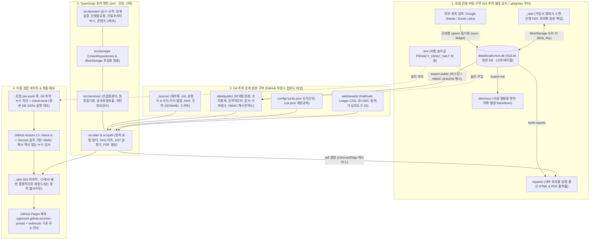
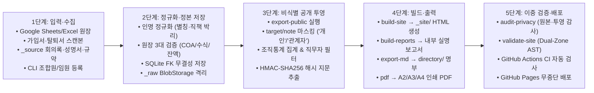

# 우체국물류지원단 물류노동조합 종합 포털 (`union-portal`) 아키텍처 · 모듈 · 인수인계 종합 해설서

> **문서 목적**: 이 문서는 노동조합 집행부·사무국장·웹 관리자가 교체되더라도 **프로그래밍 비전문가(비개발자)가 프로젝트의 기초 원리, 전체 구조, 데이터 흐름, 보안 경계, 개별 코드 모듈, 그리고 일상 운영 실무까지 한 번에 파악하고 즉시 업무를 인계받을 수 있도록** 작성된 공식 아키텍처·운영 종합 가이드입니다.
>
> **같이 보기**: 같은 내용을 브라우저에서 좌측 목차 탐색, 키워드 실시간 검색, 글자 크기 조절, 라이트/다크 테마 전환, 고해상도 벡터 다이어그램과 함께 열람하려면 [ARCHITECTURE-HANDOVER.html](./ARCHITECTURE-HANDOVER.html) 파일을 웹 브라우저(Chrome·Edge 등)로 바로 여세요.

---

## 목차

1. [제1장. 비개발자 관리자를 위한 기초 개념 안내 (시작하기 전에)](#제1장-비개발자-관리자를-위한-기초-개념-안내-시작하기-전에)
2. [제2장. 전체 아키텍처 한눈에 보기 (4대 핵심 다이어그램)](#제2장-전체-아키텍처-한눈에-보기-4대-핵심-다이어그램)
3. [제3장. 3대 도메인 컨텍스트와 표준 용어 사전 (`GLOSSARY-MAP`)](#제3장-3대-도메인-컨텍스트와-표준-용어-사전-glossary-map)
4. [제4장. 7대 핵심 아키텍처 결정 기록 (`ADR-0001` ~ `ADR-0007`) 쉬운 해설](#제4장-7대-핵심-아키텍처-결정-기록-adr-0001--adr-0007-쉬운-해설)
5. [제5장. 폴더 및 파일 구조 완전 지도 (Git 추적 vs 로컬 격리)](#제5장-폴더-및-파일-구조-완전-지도-git-추적-vs-로컬-격리)
6. [제6장. 데이터베이스(`union.db`) 스키마 및 13개 테이블 상세 명세](#제6장-데이터베이스uniondb-스키마-및-13개-테이블-상세-명세)
7. [제7장. 기능 단위별 작동 원리 (8대 핵심 서브시스템 심층 해부)](#제7장-기능-단위별-작동-원리-8대-핵심-서브시스템-심층-해부)
8. [제8장. 소스 코드 모듈별(파일별) 상세 레퍼런스 사전](#제8장-소스-코드-모듈별파일별-상세-레퍼런스-사전)
9. [제9장. CLI 명령어 마스터 레퍼런스 (`npm run` & `union` 전체 명령)](#제9장-cli-명령어-마스터-레퍼런스-npm-run--union-전체-명령)
10. [제10장. 비개발자 관리자를 위한 상황별 실무 운영 매뉴얼 (Step-by-Step 레시피)](#제10장-비개발자-관리자를-위한-상황별-실무-운영-매뉴얼-step-by-step-레시피)
11. [제11장. 인수인계 체크리스트 및 자주 발생하는 문제 해결 (Troubleshooting FAQ)](#제11장-인수인계-체크리스트-및-자주-발생하는-문제-해결-troubleshooting-faq)
12. [제12장. 가독성·접근성(A11y) 및 디자인 시스템(`DESIGN.md`) 설계 원칙](#제12장-가독성접근성a11y-및-디자인-시스템designmd-설계-원칙)

---

## 제1장. 비개발자 관리자를 위한 기초 개념 안내 (시작하기 전에)

### 1.1 이 시스템이 해결하려는 근본 문제

노동조합이 조합원들에게 투명하게 정보를 공개하고 내부 살림을 관리할 때는 **서로 충돌하는 두 가지 요구**를 동시에 해결해야 합니다.

1. **투명한 공개의 요구**: 조합원 누구나 스마트폰에서 로그인 없이 편하게 이번 달 조합비가 어디에 쓰였는지(회계 대시보드·거래 탐색기), 운영위원회 회의에서 무엇이 결정되었는지(회의록), 노조의 입장과 노동법 해설은 무엇인지(성명서·소식지·지식 자료), 현 임기 임원과 조합 규약은 어떠한지 확인할 수 있어야 합니다.
2. **철저한 개인정보 보호의 요구**: 회계 원장 원본이나 가입서에는 조합원의 이름, 생년월일, 전화번호, 이메일, 경조사 내역, 탈퇴 사유 등 극도로 민감한 개인정보가 담겨 있습니다. 이 정보는 일반 인터넷 공간(GitHub 등)에 **단 1글자라도 올라가면 절대 안 됩니다.**

`union-portal`은 이 두 요구를 해결하기 위해 **"사무실 내 컴퓨터의 비밀 금고(로컬 정본)"**와 **"누구나 볼 수 있는 전시장(공개 정적 웹사이트)"**을 물리적으로 분리하고, 두 공간 사이에 **자동화된 비식별 변환기 + 이중 개인정보 검문소**를 세운 시스템입니다.

### 1.2 반드시 알아야 할 10가지 기초 IT 개념 (쉬운 비유 해설)

프로그래밍을 전혀 몰라도 아래 10가지 비유만 이해하면 전체 시스템의 80%를 이해한 것입니다.

| 번호 | 기술 용어 | 일상 비유 | `union-portal`에서의 실제 역할 |
| :---: | :--- | :--- | :--- |
| **1** | **정적 웹사이트 (Static Site) & GitHub Pages** | 24시간 관리인이 지키는 백화점(동적 서버)이 아니라, 미리 인쇄해 둔 완벽한 책자 묶음을 무료 전시장에 진열해 두는 방식 | 관리용 백엔드 서버 비용(월 유지비)이 `0원`이고, 서버 해킹으로 조합원 DB가 털릴 위험 자체가 원천 차단됩니다. `_site/` 폴더가 바로 이 완성된 책자 묶음입니다. |
| **2** | **로컬(Local) vs 원격 저장소(Git / GitHub)** | **로컬**은 내 사무실 책상 서랍(내 컴퓨터 하드디스크), **GitHub**는 전 세계 누구나(또는 팀원이) 볼 수 있는 인터넷 공용 게시판 | 민감한 원본은 내 컴퓨터(로컬)에만 두고, 개인정보를 모두 지운 결과물과 프로그램 코드만 GitHub에 올립니다(`git push`). |
| **3** | **`.gitignore` (출입 통제 명단)** | 우체국 택배 상자에 넣지 말아야 할 물품 목록을 적은 금지 스티커 | `data/local/`, `_raw/`, `directory/`, `reports/`, `_site/`, `.env` 폴더·파일이 실수로라도 `git push`를 타고 인터넷에 올라가지 못하게 Git 프로그램이 자동으로 막아줍니다. |
| **4** | **SQLite 데이터베이스 (`union.db`)** | 여러 장의 엑셀 시트가 서로 꼬이지 않게 하나로 묶어 놓은 "스마트 정본 금고 파일" | 조합원 명부, 외부 인사, 직책 임기 이력, 별칭 규칙, 원장 거래, 문서-거래 연결을 `data/local/union.db`라는 **파일 딱 1개**에 안전하게 저장합니다. |
| **5** | **공개 투영 (Public Projection, `data/public/`)** | 비밀 서류 원본에서 개인 이름과 연락처를 검은 펜으로 가리고 통계 숫자만 옮겨 적은 "공개용 요약 복사본" | `export-public` 명령을 실행하면 비밀 금고(`union.db`)에서 개인정보를 제거한 JSON 파일 4종과 해시 인덱스 1종을 뽑아 `data/public/`에 저장합니다. 이 폴더만 GitHub에 올립니다. |
| **6** | **단방향 해시 (`HMAC-SHA256`) & 비밀 소금값 (`PRIVACY_HMAC_SALT`)** | 이름(`홍길동`)을 암호 지문(`a8f3...`)으로 바꾸는 믹서기. 지문만 보고는 원래 이름을 절대 복원할 수 없지만, 새로 쓴 글에 `홍길동`이 섞였는지 믹서기에 돌려 대조하면 즉시 적발 가능 | GitHub 서버에는 조합원 실명 대신 **암호 지문 목록(`privacy_hashes.json`)**만 올립니다. GitHub Secret에 비밀 소금값(`PRIVACY_HMAC_SALT`)을 넣어두면, 자동 로봇이 실명 유출 여부를 100% 잡아냅니다. |
| **7** | **CLI (명령줄 도구, `npm run union -- ...`)** | 여러 창을 마우스로 클릭하는 대신, 검은 화면(터미널/PowerShell)에 짧은 문장 한 줄을 입력해 실행하는 "만능 리모컨" | 조합원 가입(`member join`), 원장 반영(`sync-ledger`), 공개본 추출(`export-public`), 웹사이트 생성(`build-site`), PDF 인쇄(`pdf`)를 모두 한 줄 명령으로 처리합니다. |
| **8** | **TypeScript & Node.js 22 LTS** | 과거에 회계는 파이썬(Python), 자료실은 자바스크립트(JS)로 따로 쓰던 두 언어를 하나로 통일한 공용 언어와 실행 엔진 | 모든 계산·검증·웹페이지 생성·차트 그리기 규칙이 하나의 언어(`TypeScript`)로 되어 있어 규칙이 어긋나지 않습니다. |
| **9** | **Markdown (`.md`), YAML Frontmatter, JSON** | 한글·워드 대신 메모장으로 쓰는 간단한 문서 문법(`.md`), 문서 맨 위의 표지 카드(`---`로 감싼 `YAML`), 컴퓨터가 표 데이터를 주고받는 서류 양식(`JSON`) | 회의록은 `.md` 파일로 작성하고, 규약 개정 시안이나 문서 목록(`catalog.json`)은 `JSON` 파일로 관리합니다. |
| **10** | **CI/CD (GitHub Actions 자동 검문소)** | 공항 보안검색대: 내 컴퓨터에서 문서를 올릴 때마다(`git push`), GitHub의 자동 로봇이 모든 계산·링크·개인정보 검사를 통과시켜야만 최종 웹사이트에 공개 | 실수로 개인정보가 들어간 문서나 깨진 링크를 올리더라도 웹사이트가 망가지거나 실명이 공개되기 전에 자동 배포를 즉시 중단시켜 줍니다. |

---

## 제2장. 전체 아키텍처 한눈에 보기 (4대 핵심 다이어그램)

### 2.1 다이어그램 1: 전체 시스템 아키텍처 및 보안 경계도

이 시스템에서 가장 중요한 것은 **"무엇이 내 컴퓨터(로컬 비밀 구역)에 남고, 무엇이 GitHub(공개 구역)로 나가는가"**입니다. 아래 그림은 점선으로 구분된 3개의 보안 구역과 검증 관문을 한눈에 보여줍니다.



### 2.2 다이어그램 2: 5단계 데이터 생명주기 파이프라인

데이터가 처음 입력되어 조합원의 스마트폰 화면과 집행부 PDF 인쇄물까지 도달하는 전체 흐름입니다.



### 2.3 다이어그램 3: 계층형 소프트웨어 구조와 클라우드 이전 경계 (ADR-0001 · ADR-0005)

현재 1단계는 내 컴퓨터의 SQLite 파일(`union.db`)과 로컬 폴더(`_raw/`)를 쓰지만, 향후 조합원이 수백 명으로 늘어나거나 지부별 동시 접속 웹앱으로 확장할 때도 **핵심 업무 규칙(`src/domain/`, `src/services/`)을 한 줄도 뜯어고치지 않고 저장소 어댑터만 바꿔 끼울 수 있도록** 설계되어 있습니다.

```mermaid
flowchart TB
    CLI["진입 계층 (Entrypoints)\nsrc/cli/index.ts · src/site/ · src/reports/ · src/pdf/"]
    SVC["서비스 계층 (Application Services)\nsrc/services/: MemberService · syncLedger · exportPublic · auditPrivacy"]
    DOM["도메인 계층 (Pure Domain Rules — 외부 I/O 의존 없음)\nsrc/domain/: accounting · person-normalizer · privacy · content-graph · types"]
    PORT["추상 경계 (Repository & Storage Interfaces)\nsrc/storage/repositories.ts (UnionRepositories)\nsrc/storage/blob-storage.ts (BlobStorage)"]

    subgraph NOW["현재 구현체 (1단계: 로컬 우선)"]
        SQLITE["SqliteUnionRepositories\n(Drizzle ORM + @libsql/client → union.db)"]
        LOCALFS["LocalFileStorage\n(_raw/ 디렉터리 + 경로 탈출 차단)"]
    end

    subgraph FUTURE["향후 확장 구현체 (2단계: 클라우드 전환 시)"]
        PG["PostgresUnionRepositories\n(예정: 클라우드 PostgreSQL DB)"]
        S3["CloudObjectStorage\n(예정: S3 / R2 오브젝트 스토리지)"]
    end

    CLI --> SVC
    SVC --> DOM
    SVC --> PORT
    DOM -.->|"순수 함수·타입만 공유"| CLI
    PORT <|.. SQLITE
    PORT <|.. LOCALFS
    PORT <|.. PG
    PORT <|.. S3
```

### 2.4 다이어그램 4: 정본 데이터베이스(`union.db`) 13개 테이블 ERD

로컬 정본 DB는 `drizzle/0000_initial.sql`과 `drizzle/0001_officer_governance.sql`로 생성되는 **13개의 업무 테이블**(+ 마이그레이션 이력용 `__union_migrations` 1개)로 구성됩니다.

```mermaid
erDiagram
    units ||--o{ member_profiles : "소속 단위 (unit_code)"
    units ||--o{ ledger_entries : "회계 단위 (unit_code)"
    units ||--o{ membership_events : "전출·전입 (from_unit, to_unit)"

    people ||--o| member_profiles : "조합원 상세 (1:0..1 CASCADE)"
    people ||--o| external_profiles : "외부인 상세 (1:0..1 CASCADE)"
    people ||--o{ membership_events : "가입·탈퇴·이동 이력"
    people ||--o{ member_documents : "증빙 서류"
    people ||--o{ person_aliases : "별칭 매핑"
    people ||--o{ person_roles : "직책·임기·공개등급"
    people ||--o{ ledger_person_links : "거래 내 인명 감지"

    membership_events ||--o{ member_documents : "이벤트별 첨부 (CASCADE)"
    ledger_entries ||--o{ membership_events : "탈퇴 환급 거래 (refund_tx_id)"
    ledger_entries ||--o{ ledger_person_links : "거래-인물 매핑 (CASCADE)"
    ledger_entries ||--o{ document_ledger_links : "거래 참조 보호 (RESTRICT)"

    units {
        text code PK "HQ, AY, BP, SS"
        text official_name "본조, 안양지부, 부평지부, 서서울지부"
        text short_name "본부, 안물, 부평물, 서물"
        text status "active | closed"
    }
    accounts {
        text category PK "수입|지출|내부이전|기초이월|이월차액"
        text gwan PK "관(대분류)"
        text hang PK "항(중분류)"
        text mok PK "목(활동)"
    }
    people {
        text person_id PK "M-XXXX 또는 E-XXXX"
        text kind "member | external"
        text name "정식 성명"
        text status "active|inactive|retired|withdrawn|leave"
    }
    member_profiles {
        text person_id PK,FK
        text unit_code FK
        text birth_date "생년월일"
        text shift "근무형태"
        text employment_type "공무직|기간제"
        text application_doc_key "BlobStorage 논리 키"
    }
    external_profiles {
        text person_id PK,FK
        text org "소속기관"
        text category "분류"
    }
    membership_events {
        text event_id PK "EV-XXXX"
        text person_id FK
        text event_type "join|withdraw|rejoin|transfer|..."
        text event_date "YYYY-MM-DD"
        text refund_tx_id FK "환급 거래번호"
    }
    member_documents {
        text doc_id PK "DOC-XXXX"
        text event_id FK
        text person_id FK
        text doc_type "가입서|탈퇴서|기타"
        text blob_key "applications/..."
    }
    person_aliases {
        text alias PK "별칭·약칭"
        text person_id FK
        text match_mode "exact | context_title"
    }
    person_roles {
        text role_id PK "R-XXXX"
        text person_id FK
        text title "직책명"
        text public_disclosure "public_official | masked"
        text role_scope "executive|branch_head|auditor|..."
        text term_label "기수"
        integer sort_order "정렬 서열"
    }
    ledger_entries {
        text tx_id PK "거래번호 (HQ-2026-001 등)"
        text unit_code FK
        text ym "보고월 YYYY-MM"
        text gubun "거래 구분"
        text gwan "관"
        text hang "항"
        text mok "목"
        integer inc "수입(원)"
        integer exp "지출(원)"
        integer unit_bal "단위 누적잔액(원)"
    }
    document_ledger_links {
        text doc_id PK "문서 ID (mom:202607 등)"
        text tx_id PK,FK "원장 거래번호 (ON DELETE RESTRICT)"
        text relation_note "연결 설명"
    }
    strip_tokens {
        text category PK "honorific|modifier|title"
        text token PK "제거 토큰"
    }
    privacy_rules {
        text rule_type PK "forbidden_name|target_mask|note_replacement"
        text match_key PK "매칭 키"
        text replacement "치환 문자열"
    }
    sync_metadata {
        text sync_key PK "ledger_sync 등"
        text value_json "동기화 요약 JSON"
    }
```



---

## 제3장. 3대 도메인 컨텍스트와 표준 용어 사전 (`GLOSSARY-MAP`)

`union-portal`은 [GLOSSARY-MAP.md](../GLOSSARY-MAP.md)를 중심으로 **조직(`organization`)**, **회계(`accounting`)**, **자료실(`archive`)** 3개 영역이 서로 맞물려 돌아갑니다. 업무 인수인계 시 가장 먼저 **용어를 정확히 통일**해야 회의록, 원장, CLI 명령 사이에서 혼선이 생기지 않습니다.

### 3.1 조직(`Organization`) 컨텍스트 (`src/organization/GLOSSARY.md`)

1. **조직단위 (`Unit`) vs 사업장(사업소)**:
   - **조직단위**는 노동조합 내부의 공식 기구 단위이며, **사업장(사업소)**은 사측(우체국물류지원단)의 물리적 근무 현장을 뜻합니다. 둘을 섞어 쓰면 안 됩니다.
   - `config/units.json`에 등록된 4개 조직단위:
     | 코드 | 공식 명칭 (`officialName`) | 표·회계 약칭 (`shortName`) | 전체 명칭 (`fullName`) | 상태 | 비고 |
     | :--- | :--- | :--- | :--- | :---: | :--- |
     | `HQ` | **본조** | **본부** | 우체국물류지원단 물류노동조합 본조합 | `active` | 조합비 수납, 교부금 배분, 중앙 교섭·복지 총괄 (시트: `원장_본부`) |
     | `AY` | **안양지부** | **안물** | 안양물류센터지부 | `active` | 안양물류센터 현장 지부 (시트: `원장_안물`) |
     | `BP` | **부평지부** | **부평물** | 부평물류센터지부 | `active` | 부평물류센터 현장 지부 (시트: `원장_부평물`) |
     | `SS` | **서서울지부** | **서물** | 서서울물류센터지부 | `closed` | 2024년 3월 폐지 지부 (잔여노조비 1,000,000원 본부 회수 완료, 과거 기록 보관용) |
   - *피해야 할 용어(Avoid)*: 부서, 분회, 지점, 센터, 본사/중앙(본조 대신 쓸 때).

2. **인물 (`Person`) 통합 모델**:
   - 조합원(`member`, ID: `M-XXXX`)과 외부 인사(`external`, ID: `E-XXXX`, 본사·연대노조·상급단체 등)를 하나의 상위 개체 `people`로 통합 관리합니다.
   - 이를 통해 회계 거래, 회의록, 직책 이력, 별칭 규칙이 모두 동일한 `person_id`를 바라보게 됩니다.

3. **공적 노출 등급 (`PublicDisclosure`) 및 7가지 직책 구분 (`RoleScope`)**:
   - **공적 직무자 (`public_official`)** vs **비식별 (`masked`)**: 선출·임명 공식 직무자(위원장·사무국장·지부장·운영위원·감사)와 외부 공적 대표자(연대노조·교섭대표노조 위원장 등)의 **공적 직무 활동(회의 참석·공식 발언·성명서)**에 한해 임기 기간(`valid_from` ~ `valid_to`) 내에서만 실명과 직책을 공개 웹에 허용합니다.
   - **7가지 `roleScope`**:
     - 공개 가능 대상: `executive`(집행부), `branch_head`(지부장), `auditor`(감사), `committee`(특별기구), `external_rep`(타노조·외부 대표 — 단, 조합 현황 `/union/` 카드에서는 제외하고 회의록 검증에만 사용)
     - 비공개 강제 대상: **`staff_rotating`(순번제 소통간사 등 — 시스템 코드 레벨에서 `public_official` 설정을 원천 차단)**, `other`(기타)
   - **개인·재정 정보 전면 비식별 원칙**: 전·현직 임원이라 할지라도 회계 원장, 개인 찬조, 경조사, 실비 지출 등 **재정·신상 문맥에서는 예외 없이 전원 비식별** 처리합니다.
   - **인명 표기 원칙**: 내부 회계 원장·결산표에는 존칭·수식어·직책을 떼고 **정식 성명만(`name_only`)** 기록하며, 회의록·성명서 등 공적 문서에서는 `성명(직책)` 또는 `직책 성명` 병기를 허용합니다.

### 3.2 회계(`Accounting`) 컨텍스트 (`src/accounting/GLOSSARY.md`)

1. **회계단위와 2대 재원 (`fundTypes`)**:
   - **회계단위**: 자금의 수입과 지출을 독립 결산하는 역할(`HQ`, `AY`, `BP`, `SS`).
   - **일반회계**: 정기 조합비와 통상 수입으로 조합의 경상·정기 활동을 집행하는 기본 재원.
   - **특별모금·찬조**: 소송 연대, 워크샵 등 특정 목적을 위해 모금하거나 지정 찬조를 받아 집행하는 목적성 재원.

2. **6대 거래 구분 (`gubun`)과 통합 결산 상계 원리**:
   - `수입`: 회계단위 외부(급여공제 조합비, 찬조, 이자 등)에서 들어오는 순수 자금 증가.
   - `지출`: 회계단위 외부(식당, 인쇄소, 선물 등)로 실제 소비·유출되는 순수 자금 감소.
   - `내부이전(전입)` / `내부이전(전출)`: 본부와 지부 사이의 자금 이동(정기 교부금, 행사 특별지원금, 폐지 지부 잔여금 회수). **전체 통합 결산 시 이중 계산을 막기 위해 자동으로 상계(`trNet = trIn - trOut`)**되며, 본부 기준 총지출은 `hqExp = exp + trOut`으로 별도 계산합니다.
   - `기초이월`: 통합 원장 개시 시점(2022년 12월 23일)의 초기 통장잔액 승계분.
   - `이월차액`: 월별 결산 마감 잔액과 다음 달 이월 통장잔액 간의 불일치 차액(결산이자 합산 이월, 미기재 지출 등) 조정 항목.

3. **기간 속성 및 10대 지출형태 (`expType`)**:
   - **보고월 (`ym`)**: 월별 조합비 현황표에 보고·마감된 기준 연월(`YYYY-MM`).
   - **귀속월 (`attrYm`)**: 실제 현금 입출금 날짜와 무관하게 해당 조합비나 교부금이 귀속되는 대상 연월(`YYYY-MM`).
   - **지출형태 (`expType`)**: 활동 목적이 아니라 실제 돈이 쓰인 물리적 수단 10종 (`식대`, `다과·음료`, `인쇄·제작`, `물품·비품`, `선물·상품권`, `교통·숙박`, `경조금·화환`, `찬조·기부금`, `교부·환급`, `기타`).

4. **3단계 계정과목 체계 (`관 · 항 · 목`, `config/coa.json`)**:
   - **수입 3대 관**: `조합비수입`(공무직/기간제 조합비), `기부·찬조수입`(운영위·임원개인·지부·우본연대·목적성 모금), `기타수입`(결산이자, 카드캐쉬백, 비용분담금 환입, 지급오류 환수·반환).
   - **지출 5대 관**:
     - `운영비` (회의비, 총회·의결기구, 사무·행정비)
     - `교섭·투쟁·권익비` (교섭·사측면담, 선전·홍보, 법률·노동안전)
     - `조직·교육비` (조직확대·현장활동, 교육·워크샵)
     - `조합원복지·연대비` (명절·기념일, 경조·예우, 대외연대·찬조)
     - `조정·환급` (조합비 환급, 이월차액)
   - **기타**: `내부이전`(정기교부금, 특별지원, 잔여금 정산), `기초이월`(전년도 이월잔액).

### 3.3 자료실(`Archive`) 컨텍스트 (`src/archive/GLOSSARY.md`)

1. **5대 자료 문서 범주 (`category`)**:
   - `statement`(성명서), `newsletter`(현장 소식지), `mom`(운영위원회 회의록 — 일반 `minutes` 및 종합 결산 `report`), `knowledge`(지식 자료), `notice`(알림).
2. **3단계 게시 가시성 (`workflow.visibility`)**:
   - `public`(전체 공개): 목록, 홈, `sitemap.xml`에 모두 등재되고 검색엔진에 노출됩니다.
   - `unlisted`(미등재): HTML 페이지는 생성되지만 목록과 `sitemap.xml`에서 빠지고 `<meta name="robots" content="noindex,follow">`가 붙습니다. 링크를 아는 사람만 열람할 수 있는 검토용 문서입니다.
   - `internal_only`(내부 전용): 공개 사이트(`_site/`) 빌드 과정에서 **아예 제외**되어 HTML 파일조차 생성되지 않습니다.
3. **문서 ↔ 회계 양방향 연계**:
   - **기준월 (재정 연동) (`financePeriod`)**: 운영위원회 회의록(`mom`)이 참조하는 보고월(`YYYY-MM`). 해당 월의 재정 요약과 거래 내역이 회의록 하단에 자동 첨부됩니다.
   - **문서-거래 연결 (`document_ledger_links`)**: 성명서·회의록·소식지·지식 문서와 관련 회계 거래(`tx_id`)를 다대다로 연결해, 문서에서는 관련 집행 내역을, 거래 탐색기에서는 해당 지출의 근거 문서를 서로 클릭해 오갈 수 있게 합니다.
4. **규약 개정 다회차 심의 (`bylaws-revision`)**:
   - **규약 개정 심의안**: `초기 검토 시안`(`revisedLines`, 불변 기준선) → `회의 반영 잠정안`(`workingLines`) → `최종 상정안`으로 구분됩니다.
   - **5단계 조문별 심의 상태**: `검토 대기`(`pending`) → `차기 의제`(`scheduled`) → `논의·보류`(`discussing`) → `개정 잠정확정`(`confirmed_revision`) 또는 `현행유지 확정`(`confirmed_current`).
   - **상정 차수 (`targetWave`)**: `차수 미정`(`unassigned`), `1차 상정`(`wave-1`), `2차 상정`(`wave-2`).
   - **조문별 심의 기록 (`meetingLogs`)**: 개인 실명 없이 직책·기구명(`위원장`, `운영위 합의`, `규약개정 TF` 등)만으로 회의 날짜, 요지, 결정 사항을 누적 기록합니다.

---

## 제4장. 7대 핵심 아키텍처 결정 기록 (`ADR-0001` ~ `ADR-0007`) 쉬운 해설

이 프로젝트의 모든 기술적 선택에는 명확한 이유가 있으며, [docs/adr/](./adr/) 폴더에 7건의 아키텍처 결정 기록(ADR)으로 남아 있습니다.

| 번호 | 결정 제목 | 왜 이런 결정을 내렸는가? (문제 배경) | 포기한 대안과 이유 | 관리자가 기억해야 할 실무 결과 |
| :--- | :--- | :--- | :--- | :--- |
| **ADR-0001** | 비로그인 정적 공개 포털 + 로컬 관리 우선 및 클라우드 이전 경계 | 조합원 규모(약 60명)에서 상시 웹 서버와 외부 DB를 운영하면 비용과 개인정보 유출 위험이 과도하게 큼 | 처음부터 클라우드 서버 구축(보안·비용 부담) / 구조 없이 단순 스크립트 작성(추후 이전 불가) | 현재는 0원 서버비의 안전한 정적 포털로 운영하되, 모든 코드가 `Repository`와 `BlobStorage` 인터페이스만 통하므로 향후 클라우드 이전이 쉬움 |
| **ADR-0002** | 신규 단일 통합 모노레포(`union-portal`) 채택 및 기존 저장소 리다이렉트 | 과거 회계(`accounting`)와 자료실(`workplace`) 저장소가 분리되어 인명·비식별 검증·재정 연계를 맞출 수 없었음 | 기존 저장소 한쪽에 흡수 또는 분리 유지(이중 관리와 수치 불일치 발생) | 하나로 합치되, 기존 공유 링크가 깨지지 않도록 `generate-redirects`로 `redirects/` 안내 페이지를 생성해 유지함 |
| **ADR-0003** | 공개 웹 실명·개인정보 차등 공개 원칙 (공적 직무 vs 개인·재정 분리) | 회계에서는 이름을 가리고 회의록에서는 임원·찬조자 실명을 그대로 쓰다 보니 서로 대조하면 개인정보가 유출되는 문제가 있었음 | 전체 전면 비식별(공식 회의록 기록성 훼손) / 기존 이원화 유지(교차 유출 발생) | 공식 직무자의 **공적 활동**만 임기 내 실명 허용. 일반 조합원·순번제 소통간사·**모든 재정/찬조/경조사 문맥은 전원 비식별** |
| **ADR-0004** | TypeScript(Node.js 22 LTS) 단일 스택 통합 | 회계는 Python(`matplotlib`), 자료실은 Node.js로 나뉘어 있어 동일한 인명·개인정보 규칙을 두 번 짜야 했음 | 하이브리드 유지(중복 구현·클라우드 이전 난항) / Python 단일화(기존 Node 검증기 전면 재작성) | 보고서 차트는 Python PNG 대신 **인라인 SVG**로, PDF 출력은 **로컬 Chrome/Edge 헤드리스** 단일 CLI로 통합해 설치 환경을 단순화함 |
| **ADR-0005** | SQLite 정본 DB + Repository 추상화 및 동기화 어댑터 경계 | JSON 파일과 단방향 캐시로 나뉘어 외래키 무결성과 직책 임기 이력을 지키기 어려웠음 | 파일 기반 정본 유지(무결성 깨짐) / Google Sheets 즉시 폐기(입력기 새로 개발해야 해 부담 과다) | 회계 입력은 편한 Google Sheets를 그대로 쓰되 **단방향(`tx_id` upsert) 동기화**만 허용. 연결된 거래가 빠지면 즉시 에러로 차단 |
| **ADR-0006** | 비식별 공개 투영 JSON 커밋 및 CI 비밀 솔트 해시 검증 게이트 | 원본 DB(`union.db`)는 Git에 못 올리는데, 그렇다고 생성된 HTML 50여 개를 매번 커밋하면 수정 내역이 지저분해지고 Git 웹 편집 시 실명 누수를 못 막음 | HTML 전체 커밋(충돌 잦음) / 로컬 검사만 의존(웹 편집이나 훅 우회 시 유출 위험) | `data/public/`의 비식별 JSON과 해시 지문만 커밋. `PRIVACY_HMAC_SALT`를 로컬 `.env`와 GitHub Secret에 똑같이 보관해 이중 검사 |
| **ADR-0007** | 다회차 규약 개정 심의를 위한 Git 정본 JSON 및 브라우저 로컬 편집·내보내기 경계 | 66개 규약 조문을 한 번에 의결하기 어려워 여러 차례 회의마다 나눠 심의·기록하되 서버 없는 정적 웹 원칙을 지켜야 했음 | 백엔드 API 서버 신설(ADR-0001 위반) / 로컬 DB 메모(운영위원이 웹에서 공유 열람 불가) | 미등재 페이지에서 브라우저 `localStorage`로 회의 중 기록하고, 회의 후 **정본 JSON 다운로드**로 `_source/union/bylaws-revision.json`에 커밋 |

---

## 제5장. 폴더 및 파일 구조 완전 지도 (Git 추적 vs 로컬 격리)

프로젝트 루트(`c:\union-portal\`) 안의 모든 폴더는 **"GitHub에 올려도 되는 공개/코드 구역"**과 **"내 컴퓨터에만 보관해야 하는 비밀 구역"**으로 엄격히 나뉩니다.

### 5.1 공개·코드 구역 (Git 추적 O — GitHub 업로드 대상)

| 경로 | 역할 및 포함 내용 | 관리 방식 / 주의사항 |
| :--- | :--- | :--- |
| `src/` | 시스템 전체 TypeScript 프로그램 코드 (`domain/`, `storage/`, `services/`, `site/`, `reports/`, `pdf/`, `cli/`) | 개발·유지보수 코드. 도메인/서비스는 `UnionRepositories` 인터페이스만 사용 |
| `drizzle/` | SQLite DB 테이블 생성 및 변경 SQL 설계도 (`0000_initial.sql`, `0001_officer_governance.sql`) | `union migrate` 실행 시 순서대로 자동 적용됨 |
| `config/` | 비민감 마스터 설정 (`units.json` 조직단위 4종, `coa.json` 계정과목 3단계 체계) | 새 계정과목(목)이나 지부가 생기면 이 파일을 먼저 수정 후 동기화 |
| `_source/` | 자료실 및 규약 원본 데이터 (`catalog.json`, `topics.json`, `sources.json`, `schemas/*.json`, `mom/*.md`, `statement/*.body.html`, `newsletter/`, `knowledge/`, `notice/`, `union/bylaws*`) | 공개/미등재 문서 작성 시 수정. **실명 개인정보 입력 절대 금지** (공적 직무자만 공적 문맥에 허용) |
| `data/public/` | 로컬 DB에서 개인정보를 제거하고 뽑아낸 공개 투영 JSON (`ledger_public.json`, `org_summary.json`, `public_officials.json`, `document_ledger_links.json`, `privacy_hashes.json`) | **손으로 직접 고치지 말고** 반드시 `npm run export:public` 명령으로 재생성 후 커밋 |
| `web/assets/` | 포털 CSS 디자인(`app.css`, `newsletter.css`), 클라이언트 JS(`dashboard.js`, `ledger.js`, `bylaws*.js` 등), 로고/파비콘/소셜카드 이미지, `vendor/chart.umd.min.js` | 빌드 시 SHA-256 해시가 파일 주소에 붙어 캐시 갱신됨 |
| `test/` | Node.js 내장 테스트 러너 기반 8개 자동화 테스트 스위트 (`*.test.ts`) | 가짜 인명(`홍길동`, `김철수`, `이영희`, `M-9001` 등)만 사용 |
| `docs/` | 아키텍처 결정 기록(`docs/adr/0001`~`0007`) 및 본 인수인계 해설서(`ARCHITECTURE-HANDOVER.md/.html`) | 인수인계 및 설계 기준 문서 |
| `.github/workflows/` | GitHub Actions 자동 빌드·검증·GitHub Pages 배포 설정(`pages.yml`) | `main` 브랜치 푸시 시 자동 작동 |
| `.githooks/` | 내 컴퓨터에서 `git push` 하기 직전 실수를 막아주는 안전장치(`pre-push`) | 최초 설치 후 `npm run prepare:hooks`로 활성화 필수 |

### 5.2 로컬 전용 비밀·산출물 구역 (Git 추적 X — `.gitignore` 자동 차단)

| 경로 | 역할 및 포함 내용 | 왜 Git에서 제외하는가? | 백업 및 인수인계 방법 |
| :--- | :--- | :--- | :--- |
| **`data/local/`** | **`union.db` (로컬 정본 SQLite DB)** + WAL 임시파일 | 조합원 전체 실명, 생년월일, 전화번호, 이메일, 원본 원장 적요 포함 | **가장 중요한 비밀 금고**. 암호화된 USB나 사내 보안 드라이브로 직접 인수인계 |
| **`_raw/`** | 조합원 가입서·탈퇴서 원본 스캔 이미지, 은행 PDF, `_raw/applications/*.md` 카드, 과거 회의록 원본 백업(`mom_originals/`) | 실명·서명·계좌번호가 담긴 스캔 원본 | `union.db`와 함께 오프라인/암호화 백업으로 직접 인수인계 |
| **`.env`** | 비밀 소금값 `PRIVACY_HMAC_SALT` 설정 파일 | 이 소금값이 노출되면 해시 인덱스(`privacy_hashes.json`) 대조 공격의 여지가 생김 | 전임자에게 값을 받아 복사하거나 GitHub Secret과 동일하게 설정 (`.env.example` 참고) |
| `directory/` | `export-md` 명령으로 뽑은 사람 열람용 Markdown 명부(`README.md`, `members.md`, `officers.md`, `external_people.md`, `title_rules.md`) | 정본 DB에서 파생된 실명 명부 뷰 | 언제든 `npm run union -- export-md`로 다시 생성 가능 |
| `reports/` | `build-reports`로 만든 내부 회의용 실명 결산 보고서(`monthly/`, `annual/`) 및 `pdf` 명령으로 뽑은 인쇄 PDF(`reports/pdf/`) | 실명이 포함된 내부 회의용 출력물 | 언제든 `npm run build:reports`, `npm run union -- pdf`로 재생성 가능 |
| `_site/` | `build-site` 명령으로 생성되는 완성된 정적 웹사이트 HTML 폴더 | 매번 `_source/`와 `data/public/`으로 똑같이 다시 지을 수 있는 파생 산출물 (GitHub Actions CI가 배포 직전 새로 생성) | 로컬 미리보기용. Git 커밋 불필요 |
| `redirects/` | 과거 `accounting`, `workplace` GitHub Pages용 리다이렉트 HTML 묶음 | 기존 구 주소 저장소에 복사해 배포하기 위한 생성물 | 필요 시 `npm run generate:redirects`로 재생성 |

---

## 제6장. 데이터베이스(`union.db`) 스키마 및 13개 테이블 상세 명세

SQLite 정본 데이터베이스는 `src/storage/sqlite/schema.ts`에 Drizzle ORM 형식으로 정의되어 있으며, `drizzle/0000_initial.sql`과 `drizzle/0001_officer_governance.sql` 두 SQL 파일로 테이블을 생성합니다. DB 연결 시(`openSqliteConnection`) 항상 `PRAGMA foreign_keys = ON;`, `PRAGMA journal_mode = WAL;`, `PRAGMA busy_timeout = 5000;`이 적용되어 데이터 정합성을 강제합니다.

### 6.1 마스터 기준 테이블 (2개)
1. **`units` (조직·회계단위)**
   - **기본키(PK)**: `code` (`HQ`, `AY`, `BP`, `SS`)
   - **주요 컬럼**: `name`, `official_name`(정식명: `본조`, `안양지부` 등), `short_name`(약칭: `본부`, `안물` 등), `full_name`, `status`(`active` | `closed`), `opened_on`, `closed_on`, `ledger_sheet`, `raw_dir`, `note`.
2. **`accounts` (3단계 계정과목 체계 — COA)**
   - **복합 기본키(PK)**: `(category, gwan, hang, mok)`
   - **주요 컬럼**: `description` (항목 설명). `config/coa.json`과 동기화되어 원장 검증 시 기준표 역할을 합니다.

### 6.2 인물·조합원·직책·별칭 거버넌스 테이블 (7개)
3. **`people` (인물 통합 마스터)**
   - **기본키(PK)**: `person_id` (`M-XXXX` 조합원, `E-XXXX` 외부인)
   - **주요 컬럼**: `kind`(`member` | `external`), `name`(정식 성명), `phone`, `email`, `status`(`active`, `inactive`, `retired`, `withdrawn`, `leave`), `note`.
4. **`member_profiles` (조합원 상세 프로필 — `people`과 1:1)**
   - **기본키/외래키(PK/FK)**: `person_id` → `people.person_id` (`ON DELETE CASCADE`)
   - **외래키(FK)**: `unit_code` → `units.code`
   - **주요 컬럼**: `birth_date`, `shift`(근무형태), `employment_type`(`공무직`/`기간제` 등), `first_joined_on`(최초가입일), `joined_on`(최근가입/재가입일), `left_on`(탈퇴일), `member_wish`(바라는 점), `application_doc_key`(대표 가입서 `BlobStorage` 논리 키).
5. **`external_profiles` (외부 인사 프로필 — `people`과 1:1)**
   - **기본키/외래키(PK/FK)**: `person_id` → `people.person_id` (`ON DELETE CASCADE`)
   - **주요 컬럼**: `org`(소속 기관/타노조), `category`(구분).
6. **`membership_events` (조합원 가입·탈퇴·재가입·이동 이력)**
   - **기본키(PK)**: `event_id` (`EV-XXXX`)
   - **외래키(FK)**: `person_id` → `people`, `from_unit` → `units`, `to_unit` → `units`, **`refund_tx_id` → `ledger_entries.tx_id`**
   - **주요 컬럼**: `event_type`(`join`, `withdraw`, `rejoin`, `transfer`, `baseline_sync`, `ledger_import`), `event_date`, `reason_category`(`정년퇴직`, `계약만료·퇴직`, `기타`, `""`), `rejoin_category`, `reason`, `doc_md_path`(생성된 서류 카드 경로).
7. **`member_documents` (가입서·탈퇴서 증빙 파일 목록)**
   - **기본키(PK)**: `doc_id` (`DOC-XXXX`)
   - **외래키(FK)**: `event_id` → `membership_events` (`CASCADE`), `person_id` → `people` (`CASCADE`)
   - **주요 컬럼**: `doc_type`(`가입서`, `탈퇴서`, `기타`), `blob_key`(`applications/JOIN_...jpg`), `note`, `created_at`.
8. **`person_aliases` (별칭·약칭 → 정식 성명 매핑)**
   - **기본키(PK)**: `alias`
   - **외래키(FK)**: `person_id` → `people` (`CASCADE`)
   - **주요 컬럼**: `match_mode`(`exact`: 단독 일치 시 무조건 치환 / `context_title`: 뒤에 직책이나 호칭이 붙을 때만 치환), `note`.
9. **`person_roles` (직책·임기·공적 노출 등급 — `0001_officer_governance.sql` 확장)**
   - **기본키(PK)**: `role_id` (`R-XXXX`)
   - **외래키(FK)**: `person_id` → `people` (`CASCADE`)
   - **주요 컬럼**: `org`, `title`, `public_disclosure`(`public_official` | `masked`), `valid_from`/`valid_to`(`YYYY-MM`), `is_primary`, `role_scope`(`executive`, `branch_head`, `auditor`, `committee`, `staff_rotating`, `external_rep`, `other`), `term_label`(예: `제3기`), `appointed_on`/`ended_on`(`YYYY-MM-DD`), `end_reason`, `sort_order`(기본 100), `evidence_doc_id`(임명 근거 문서 ID), `note`.

### 6.3 개인정보 보호 규칙 및 회계·문서 연계 테이블 (4개)
10. **`strip_tokens` (인명 앞뒤 제거 대상 호칭·수식어·직책 사전)**
    - **복합 기본키(PK)**: `(category, token)` (`category` ∈ `honorific`, `modifier`, `title`).
11. **`privacy_rules` (금칙어 및 원장 비식별 치환 사전)**
    - **복합 기본키(PK)**: `(rule_type, match_key)` (`forbidden_name`, `target_mask`, `note_replacement`), `replacement`, `note`.
12. **`ledger_entries` (회계 원장 스냅샷)**
    - **기본키(PK)**: `tx_id` (예: `HQ-2026-001`)
    - **외래키(FK)**: `unit_code` → `units.code`
    - **주요 컬럼**: `unit_name`, `year`, `ym`(보고월), `date`, `gubun`, `gwan`, `hang`, `mok`, `exp_type`, `fund`, `target`, `attr_ym`(귀속월), `inc`, `exp`, `unit_bal`, `note`, `memo`.
13. **`ledger_person_links` (거래 내 등장 인물 자동 연결)**
    - **복합 기본키(PK)**: `(tx_id, person_id)` — 양쪽 모두 `ON DELETE CASCADE`, `match_field`(`target` | `note`).
14. **`document_ledger_links` (자료 문서 ↔ 회계 거래 명시적 양방향 연결)**
    - **복합 기본키(PK)**: `(doc_id, tx_id)` — **`tx_id`는 `ledger_entries.tx_id`에 대해 `ON DELETE RESTRICT`!**
    - **왜 `RESTRICT`인가?** Google Sheets에서 누군가 실수로 연결된 거래번호(`tx_id`)를 삭제하거나 번호를 바꿔버렸을 때, 자료실 회의록과 회계 원장의 연결 고리가 소리 없이 끊어지는 것을 막기 위해 원장 동기화 자체를 실패시킵니다.
15. **`sync_metadata` (동기화 상태 메타데이터)**
    - **기본키(PK)**: `sync_key` (`ledger_sync`), `value_json`, `updated_at`.

> 참고: 위 업무 테이블 외에 마이그레이션 실행 내역을 기록하는 내부 관리 테이블 `__union_migrations(id, applied_at)` 1개가 자동 생성됩니다.

---

## 제7장. 기능 단위별 작동 원리 (8대 핵심 서브시스템 심층 해부)

### 7.1 조합원·외부인·직책·별칭 관리 시스템 (`MemberService`)

`src/services/member-service.ts`의 `MemberService` 클래스가 담당하며, 모든 변경 작업은 `repos.transaction(...)` 안에서 원자적으로(전부 성공하거나 전부 롤백) 실행됩니다.

1. **가입(`joinMember`)과 자동 재가입 판정**:
   - 입력된 `unit`(코드 `AY`, 정식명 `안양지부`, 약칭 `안물` 중 무엇이든 가능)을 `resolveUnitCode`로 표준 코드로 변환합니다.
   - **중요 안전 기능**: 만약 `--birth`가 입력되었고, DB에 `이름 + 생년월일`이 똑같은 **비활동(`status !== 'active'`) 과거 조합원**이 1명 존재하면, 새 `M-XXXX` 번호를 따지 않고 **자동으로 `rejoin`(재가입) 모드로 전환**해 기존 `M-XXXX` ID와 `firstJoinedOn`(최초 가입일)을 승계합니다.
   - 신규 가입이면 `M-0001` 식으로 다음 순번 ID와 `EV-0001` 이벤트 ID를 발급하고, 첨부된 가입서 스캔 파일을 `LocalFileStorage`(`_raw/applications/JOIN_YYYYMMDD_M-XXXX_이름.확장자`)에 저장한 뒤, `privacy_rules`에 `forbidden_name`으로 이름을 자동 등록해 이후 공개 웹에 실명이 나가는 것을 즉시 차단합니다.
2. **탈퇴(`withdrawMember`)와 환급 검증 + 직책 자동 종료**:
   - `--id` 또는 `--name`으로 대상 조합원을 찾습니다(동명이인이 2명 이상이면 실수를 막기 위해 에러를 내고 `--id` 지정을 요구합니다).
   - `--refund-tx`로 조합비 환급 거래번호가 입력되면, `ledger_entries`에 실제 해당 `tx_id`가 존재하는지 먼저 검사합니다.
   - 조합원 상태를 `withdrawn`으로 바꾸고 `withdraw` 이벤트를 기록하는 동시에, **이 조합원이 맡고 있던 모든 현임 직책(`person_roles` 중 `validTo`와 `endedOn`이 비어 있는 행)을 `endReason: '탈퇴'`로 자동 종료**합니다. (역대 이력은 삭제하지 않고 보존합니다.)
3. **임원 직책 거버넌스 (`appointRole`, `transferRole`, `endRole`, `setRoleDisclosure`)**:
   - `appointRole`: `roleScope`를 주지 않으면 조합원은 `executive`, 외부인은 `external_rep`로 추론하며, `staff_rotating`(순번제 소통간사)과 `other`는 공개 등급을 자동으로 `masked`로 설정합니다. **특히 `roleScope === 'staff_rotating'`이면서 `publicDisclosure === 'public_official'`로 임명·전환하려 하면 `ADR-0003` 위반 오류를 내어 원천 차단**합니다.
   - `transferRole`: 기존 직책(`R-XXXX`)을 `보직변경`으로 종료 마감하고(`validTo`, `endedOn` 기록), 같은 사람의 새 직책(`R-YYYY`)을 연속으로 생성합니다.
4. **로컬 명부 Markdown 자동 생성 (`exportDirectoryMarkdown`)**:
   - `export-md` 명령은 DB를 읽어 `directory/` 폴더에 `README.md`, `members.md`, `officers.md`, `external_people.md`, `title_rules.md` 5개 파일과 `_raw/applications/*.md` 개별 서류 카드(가입/재가입/탈퇴 요약 + 원본 이미지 미리보기 링크 포함)를 생성합니다.

### 7.2 인명 정규화 엔진 (`person-normalizer.ts`)

회계 담당자가 Google Sheets 원장의 `대상(target)`이나 `비고(note)` 칸에 `"홍길동 위원장님"`, `"전 직무대행 김철수 님"`, `"이영희님 모친상"`처럼 제각각 적어 넣더라도, 시스템은 `normalizePersonMentions()` 3단계 파이프라인을 통해 이를 깔끔한 정식 성명(`"홍길동"`, `"김철수"`, `"이영희 모친상"`)으로 통일합니다.

- **1단계 (별칭 해결)**: `person_aliases` 목록을 글자 수 긴 순서대로 대조해 별칭을 정식 성명(`idToName[personId]`)으로 바꿉니다.
  - `exact` 모드: 앞뒤가 한글이 아니면 치환 (예: `"길동"` → `"홍길동"`, 단 `"길동무"`처럼 한글이 이어지면 치환 안 함).
  - `context_title` 모드: 동음이의 일반 단어가 실수로 바뀌지 않도록, 뒤에 직책이나 존칭이 붙었을 때만 치환합니다.
- **2단계 (등록 성명 앞뒤 호칭·수식어·직책 박리)**: `strip_tokens` 테이블(또는 기본값 `DEFAULT_STRIP_TOKENS`: 존칭 7종 `선생님/여사님/여사/선생/귀하/님/씨`, 수식어 4종 `직무대행/신임/전/현`, 직책 23종 `위원장/부위원장/사무국장/지부장/반장...`)을 조합한 정규식으로 등록된 성명 앞뒤에 반복적으로 붙은 수식·직책·존칭을 한꺼번에 벗겨냅니다.
- **3단계 (미등록 인명·경조사 폴백 제거 + 비인명 보호)**: DB에 없는 한글 2~4글자 이름 뒤에 띄어쓰고 붙은 존칭(`SPACED_HONORIFIC_RE`)이나 경조사 앞 `OOO님`(`EVENT_NIM_RE`: `모친상`, `결혼`, `퇴직` 등 앞)에서 `님`을 제거하되, `NON_PERSON_WORDS`(`부모님`, `어머님`, `선생님`, `하느님` 등 10개 단어)는 절대 건드리지 않습니다.

### 7.3 회계 원장 단방향 동기화 및 산술·참조 무결성 검증 (`sync-ledger.ts`, `accounting.ts`)

`npm run union -- sync-ledger --file <경로>`는 Excel(`.xlsx`) 또는 JSON(`.json`) 원장을 읽어 SQLite `ledger_entries`에 반영합니다.

1. **유연한 Excel 셀 파싱 (`parseLedgerFromXlsx`)**:
   - 반드시 `'통합원장'` 시트(18개 열: `tx_id`, `unit`, `year`, `ym`, `date`, `gubun`, `gwan`, `hang`, `mok`, `exp_type`, `fund`, `target`, `attr_ym`, `inc`, `exp`, `unit_bal`, `note`, `memo`)를 읽습니다.
   - Google Sheets에서 `.xlsx`로 내보낼 때 흔히 발생하는 배열/날짜 수식 wrapper(`IFERROR(__xludf.DUMMYFUNCTION("""COMPUTED_VALUE"""),"...")`)나 RichText 객체를 `unwrapExcelCell()`이 자동으로 풀어 실제 값만 추출합니다.
   - `.xlsx` 원본을 읽을 때는 자동으로 `normalizePersonMentions()`를 돌려 인명을 정식 성명으로 정규화합니다.
2. **3대 원장 무결성 검증 (`validateLedgerRecords`)**:
   - **COA(계정과목) 일치 검사**: 모든 행의 `(구분, 관, 항, 목)` 조합이 `accounts` 테이블(`config/coa.json`)에 존재하는지 확인합니다. (`내부이전(전입)`/`내부이전(전출)`은 `내부이전`으로 묶어 대조)
   - **시트 수식 오류 차단**: 주요 텍스트 필드에 `#REF!`, `#NAME?`, `#VALUE!`, `#N/A`가 남아 있으면 즉시 에러를 발생시킵니다.
   - **단위별 누적 잔액 1원 대조**: 각 `unitName`별로 `이전 잔액 + inc - exp`를 한 줄씩 누적 계산하여, 시트의 `unitBal` 값과 단 1원이라도 다르면 `Balance mismatch at <txId>` 오류를 내고 동기화를 중단합니다.
3. **참조 무결성 보호 (`replaceAllAndSyncLinks`)**:
   - 새 원장의 `tx_id` 집합에 기존 `document_ledger_links`나 `membership_events.refund_tx_id`가 참조하는 `tx_id`가 하나라도 빠져 있으면 **트랜잭션을 즉시 롤백**하여 데이터베이스를 손상시키지 않습니다.
4. **인물 자동 매핑 (`computeLedgerPersonLinks`)**:
   - 원장 `target` 또는 `note`에 DB 등록 인물의 정식 성명이 포함되어 있으면 `ledger_person_links`에 기록해(내부 집계용) 사람별 거래 추적 기반을 마련합니다.

### 7.4 차등 프라이버시 마스킹 및 공개 투영 추출 (`privacy.ts`, `export-public.ts`)

`npm run export:public`을 실행하면 로컬 DB와 `.env`의 `PRIVACY_HMAC_SALT`(없으면 32바이트 랜덤 hex를 생성해 `.env`에 자동 저장)를 이용해 `data/public/`에 **5개의 파일**을 생성합니다.

1. **`ledger_public.json`**: `sanitizeLedgerRecords()`가 아래 순서로 모든 원장 행의 민감 필드를 지웁니다.
   - `target`: 정규화 후 `privacy_rules(target_mask)` 매핑 적용 → 그래도 등록 인명(`collectPersonNames`)이 남아있으면 무조건 **`'개인'`**으로 일괄 치환.
   - `note`: 정규화 후 `privacy_rules(note_replacement)` 적용 → 그래도 인명이 남아있으면 `이름 + (님|팀장|조합원|위원장|...)` 패턴을 **`'관계자'`**로 치환.
   - `memo`: 정규화 후 인명이 남아있으면 **`'관계자'`**로 치환.
2. **`org_summary.json`**: 조합원 개인 정보는 일절 빼고 조직단위(`units`)별 활동 조합원 수, 고용형태(`byEmployment`)·근무형태(`byShift`)별 인원수, 월별 가입·재가입·탈퇴·이동 건수(`monthlyFlows`)만 순수 숫자로 집계합니다.
3. **`public_officials.json`**: `person_roles` 중 `public_disclosure === 'public_official'`인 직책만 추출합니다. 이때도 **전화번호(`phone`), 이메일(`email`), 생년월일(`birthDate`)은 절대 포함하지 않습니다.**
4. **`document_ledger_links.json`**: 문서 ID와 거래번호(`tx_id`) 연결 목록. (단, 실제 사이트 빌드 시 `internal_only` 문서에 연결된 링크는 공개하지 않습니다.)
5. **`privacy_hashes.json`**: 모든 조합원·외부인 성명, 금칙어, `exact` 별칭, 전화번호(하이픈 제거 숫자 버전 포함), 이메일을 `PRIVACY_HMAC_SALT`로 HMAC-SHA256 해싱한 지문 목록과, 스캔에 필요한 한글 이름 글자 길이 배열(`hangulLengths`, 예: `[2, 3, 4]`), 다어절 구문 존재 여부(`phraseTokens`)만 저장합니다. 원문 이름이나 전화번호는 1바이트도 들어있지 않습니다.

### 7.5 자료실 콘텐츠 그래프 v3 및 문서 렌더러 (`content-graph.ts`, `mom-renderer.ts`, `statement-fragment.ts`)

1. **콘텐츠 그래프 로더 (`loadContentGraph` / `validateSourceTree`)**:
   - `_source/topics.json`, `sources.json`, `catalog.json`과 `_source/mom/*.md` 파일들의 YAML Frontmatter를 모두 읽어 들여 `_source/schemas/*.schema.json`(JSON Schema Draft 2020-12)으로 `Ajv` 엄격 검증(`strict: true`)을 수행합니다.
   - 검사 항목: ID 접두사 일치(`mom:...`, `statement:...`), 안전한 POSIX 상대 `.html` 경로(`validateRoute`), 날짜 논리(`modifiedOn >= publishedOn`, `reviewedOn >= publishedOn`), 존재하는 주제 ID(`topicIds`)와 출처 ID(`sourceIds`), 실제 본문 파일 및 `socialImage` 존재 여부, 관련 문서(`relatedDocumentIds`)의 자기참조 및 없는 ID 차단.
2. **운영위원회 회의록 렌더러 (`mom-renderer.ts`)**:
   - `markdown-it`을 `html: false`(원시 HTML 태그 차단) 모드로 안전하게 실행하되, 표 안의 줄바꿈용 `<br>`만 예외 허용합니다.
   - 링크 URL에서 `javascript:` 등 위험 스킴을 차단하고(`sanitizeLinkUrl`), 모든 표를 `<div class="table-wrapper" tabindex="0" role="region">`로 감싸며, 각 `<td>`에 열 머리글 이름(`data-label`)을 자동으로 붙여 모바일 카드형 표가 작동하도록 만듭니다.
   - 또한 렌더링 전후로 `**` 짝이 맞지 않거나 `\[` 이스케이프 문자가 화면에 노출될 수 있는 잔재를 찾아내는 `findMarkdownSyntaxResidues()`를 제공합니다.
3. **성명서 조각 검증기 및 인쇄 밀도 계산기 (`statement-fragment.ts`)**:
   - `_source/statement/*.body.html`은 통 HTML 페이지가 아니라 본문 조각(Fragment)으로 작성합니다.
   - `parse5` AST 파서가 허용된 태그 11종(`section`, `h2`, `p`, `div`, `ol`, `ul`, `li`, `strong`, `em`, `br`, `a`)과 허용된 클래스 8종(`intro-section`, `section-title`, `body-text`, `no-indent`, `demands`, `closing-block`, `closing-highlight`, `closing-text`)만 썼는지, 맨 마지막 최상위 요소가 정확히 `closing-block`인지 엄격히 검사합니다.
   - `selectPrintDensity()`는 글자 수, 문단 수, 줄바꿈, 소제목 수, 요구사항 항목 수, 제목 줄 수를 가중 합산하여 점수가 `1400 이하`면 `short`, `2800 이하`면 `standard`, 초과면 `long` 밀도 클래스를 부여해 **A2 대자보 한 장에 딱 맞게** 글자 크기와 다단 간격을 자동 조절합니다.

### 7.6 조합 규약 체계 및 다회차 개정 심의 스튜디오 (`bylaws.ts`, `bylaws-law.ts`, `bylaws-revision.ts`)

조합 규약은 **일반 공개 열람용 2개 페이지**와 **검색 비노출(`unlisted`, `noindex,follow`) TFT·운영위 검토용 3개 페이지**로 나뉩니다.

1. **공개 규약 (`_source/union/bylaws.md` → `union/bylaws-guide.html`, `union/bylaws.html`)**:
   - `parseBylawsMarkdown()`이 전문, 제1~12장(제37조 중복 조항까지 고유 ID `art-37`, `art-37-2`로 안전 분리), 부칙 제1~3조, 별첨 2건 및 편집 주석(`*(※...)*`)까지 구조화합니다.
   - `bylaws-guide.html`: 조합원 주권 → 총회/대의원대회 → 운영위·회계감사위·선관위 → 집행부·10개 부서·지부조직을 시각화한 **인라인 SVG 거버넌스 체계도**, 규약상 주요 법정 기한·정족수 요약표, 12장 로드맵 카드를 제공합니다.
   - `bylaws.html`: `bylaws.js`와 결합해 실시간 키워드 검색(`12조` 검색 시 `제12조` 자동 매칭), 9대 주제 칩 필터, 검색어 하이라이트(`<mark>`), 조문별 영구 링크 복사 기능을 제공합니다.
2. **미등재(`unlisted`) 규약 개정 검토 3종 모음 (`ADR-0007`)**:
   - **`01. 노조법 비교 분석` (`union/bylaws-law.html`, 원본 `bylaws-law.json`)**: 2026.3.10 시행 개정 노조법 접점, 노조법 제11조 필수기재사항 15호 점검 매트릭스 막대바, 4단계 진단 등급(`risk` 시정·효력 리스크 / `recommend` 개정 권고 / `caution` 해석·운영 유의 / `aligned` 법령 부합)별 필터, TFT 우선순위 체크리스트, 근거 법령·판례 펼치기.
   - **`02. 신·구조문대비표` (`union/bylaws-revision-diff.html`) & `03. 개정안 전문 시안` (`union/bylaws-revision-full.html`, 원본 `bylaws-revision.json`)**:
     - `bylaws-revision.js`가 작동하여 회의 중 별도 서버 없이도 브라우저 `localStorage`(`union_bylaws_deliberation_v1`)에 각 조문(전문·본문·부칙·별첨 66건)의 심의 상태(`pending`~`confirmed_current`), 상정 차수(`wave-1`/`wave-2`), 수정 잠정안 문구(`workingLines`), 회의 발언 요지(`meetingLogs`)를 임시 저장합니다.
     - **실시간 개인정보 입력 차단(`detectPossiblePii`)**: 회의 기록 칸에 실수로 휴대전화 번호, 주민번호, 이메일, 혹은 `"OOO님/씨"` 같은 실명을 입력하면 경고를 띄워 직책·기구명만 적도록 안내합니다.
     - 회의 종료 후 **[정본 JSON 다운로드]** 버튼으로 `bylaws-revision.json` 파일을 내려받아 Git 저장소 `_source/union/bylaws-revision.json`에 덮어쓰고 커밋하면 전체 운영위원과 공유됩니다.

### 7.7 정적 포털 빌더 및 프론트엔드 아키텍처 (`build-site.ts`, `shell.ts`, `svg-charts.ts`, `web/assets/*`)

1. **공개 포털 4축 정보구조(IA) 및 생성 파일 전체 목록 (`buildSite`)**:
   - **홈 (`/`)**: `index.html` — 포털 3대 축 안내 카드, 최신 공적 자료실 카드, 최신 기준월 재정·조직 KPI 요약.
   - **자료실 (`/archive/`)**: `archive/index.html`, 5개 카테고리별 `index.html`, 각 `public` 및 `unlisted` 문서 상세 HTML(`archive/mom/202611.html` 등), `internal_only`는 제외. 회의록에는 `financePeriod` 기준월 재정 요약 및 관련 거래 링크 배지가 자동 삽입됨.
   - **회계 (`/accounting/`)**:
     - `accounting/index.html`: Chart.js 기반 대화형 대시보드(`dashboard.js` — 연도/단위/재원 필터, 월별 추이 확대 탐색 및 미니맵, 3단계 활동별 와플/드릴다운 탐색기, 세부활동 TOP 10, 지출방식별 구성비, 조합비 vs 교부금 추이).
     - `accounting/ledger.html`: 공개 거래 탐색기(`ledger.js` — 연도/구분/대분류/검색어/URL `?tx=` 하이라이트, 30건 페이지네이션, 연결된 자료실 문서 배지 역링크, 필터 결과 CSV 다운로드).
     - `accounting/coa.html`: 회계기준·조직단위 안내(`coa-tabs.js` 탭 + `coa-map.js` 클릭형 3단계 드릴다운 구조도).
     - `accounting/reports/index.html` 및 `monthly/YYYY-MM.html`, `annual/YYYY.html`: 월간·연간 공개 결산 보고서(연간 보고서는 외부 라이브러리 없이 `svg-charts.ts`로 생성한 **5종 인라인 SVG 차트** 내장).
     - 프론트엔드 데이터 번들: `accounting/data/public_ledger.json`, `public_ledger.js`(`window.__PUBLIC_LEDGER__`), `public_links.js`(`window.__PUBLIC_DOC_LINKS__`) — `file://` 로컬 파일로 열어도 CORS 오류 없이 작동하도록 JS 변수 번들도 함께 생성합니다!
   - **조합 (`/union/`)**: `union/index.html`(지부별 통계 카드·SVG 차트 + 현 임기 공식 직무자 카드), `bylaws-guide.html`, `bylaws.html` + 미등재 3종(`bylaws-law.html`, `bylaws-revision-diff.html`, `bylaws-revision-full.html`).
   - **메타 파일**: `.nojekyll`, `robots.txt`, `sitemap.xml`(오직 `public` 문서와 공개 페이지 목록만 포함 — `unlisted` 및 `internal_only` 철저 제외).
2. **공통 셸 및 캐시·테마 전략 (`shell.ts`, `nav.js`)**:
   - `copyAndHashAssets()`가 `web/assets/`의 모든 파일을 복사하면서 내용의 SHA-256 앞 12자 해시를 계산해 `?v=<12자>` 쿼리를 붙이므로(예: `app.css?v=a1b2c3d4e5f6`), 디자인을 고쳐도 사용자 브라우저가 옛날 캐시를 붙잡고 있을 일이 없습니다.
   - `<head>` 안의 `FOUC_THEME_SCRIPT`가 화면이 그려지기 직전에 `localStorage`의 `color-scheme`을 읽어 즉시 적용하므로 다크 모드에서 하얀 화면이 번쩍이는 FOUC 현상을 방지합니다.

### 7.8 이중 개인정보·무결성 검증 게이트 및 내부 보고서·PDF·리다이렉트

1. **원본 및 투영 감사 (`audit-privacy.ts` — `npm run audit:privacy`)**:
   - 로컬 정본 DB(`union.db`)와 `.env` 솔트가 있을 때 실행하며, ① `data/public/ledger_public.json` 회계 산술·COA 재검증, ② `data/public/*.json` 평문 및 HMAC 해시 대조 검사, ③ `_source/` 모든 비내부(`!== 'internal_only'`) 원본 문서를 줄 단위로 스캔(`auditDocumentPrivacy`)해 재정 구역 내 실명(`finance_context_name`), 비공식 직무자/임기 외 실명(`masked_person`), 휴대전화(`phone`), 개인 이메일(`email`), 경조사 실명(`family_event`)을 찾아 보고합니다.
2. **빌드 사이트 최종 검문소 (`validate-site.ts` — `validate:site` 로컬 모드 / `validate:ci` CI 모드)**:
   - 생성된 `_site/`의 **모든 `.html` 파일**을 `parse5` AST로 파싱하여 검사합니다:
     1. **HTML 구문 & 반응형**: 문법 태그 오류 여부, `<meta name="viewport">` 필수 존재 확인.
     2. **게시 가시성 계약 검증**: `internal_only` 문서가 HTML이나 `sitemap.xml`, `public_links.js`에 없는지 / `unlisted` 문서가 `robots="noindex,follow"`를 가지며 `sitemap.xml`과 공개 목록·링크에 노출되지 않았는지 / `public` 문서가 모두 빌드되고 `sitemap.xml`에 등재되었는지 확인.
     3. **링크 & 에셋 전수 검사**: 모든 `<a>`, `<link>`, ``, `<script>`, `<iframe>`의 `href`/`src`가 위험 스킴(`javascript:`, `data:text/html`, `//`)이나 루트 절대경로(`/`)를 쓰지 않고 실제 `_site/` 내부에 파일이 존재하는지 확인.
     4. **마크다운 잔재 검사**: 회의록 본문에 `**`나 `\[`가 깨져 나오지 않았는지 검사.
     5. **Dual-Zone 개인정보 검증 (`checkTextPrivacy`)**:
        - **홈·회계(`/`, `/accounting/`)**: 모든 이름 0건 허용(전면 비식별).
        - **조합(`/union/`)**: `union/index.html`에서만 조합 현직 임원 실명 허용, 규약·개정 심의 페이지 등 나머지 파일은 이름 0건.
        - **자료실(`/archive/`)**: 문서 내 `<section data-privacy-zone="finance">` 또는 `재정 현황/결산/찬조금/지출 내역` 제목 구역(`financeText`)은 **임원을 포함해 이름 0건** 강제! 그 외 일반 본문(`nonFinanceText`)에서는 해당 문서의 `eventOn`(또는 `publishedOn`) 시점에 재임 중이던 `public_official` 임원 이름만 허용합니다(`union-history` 주제이면서 `eventOn`이 없는 역사 문서는 역대 공식 임원 허용).
        - **CI 모드 vs 로컬 모드**: 로컬에서는 정본 DB 전체 이름·별칭·전화·이메일로 100% 검사하고, DB가 없는 GitHub Actions CI 모드에서는 GitHub Secret의 `PRIVACY_HMAC_SALT`와 `data/public/privacy_hashes.json`으로 해시 대조 검사를 수행합니다.
3. **내부 회의용 보고서 (`build-internal-reports.ts` — `npm run build:reports`)**:
   - 공개 사이트와 달리, **집행부 내부 회의 배포용**으로 `reports/monthly/<YYYY-MM>_운영위보고.html`과 `reports/annual/<YYYY>_대의원대회결산.html`을 생성합니다.
   - `STANDALONE_CSS`가 내장된 단일 HTML 파일이며, 원장 원본 실명 적요와 지부별 공무직/기간제 조합원 통계 스냅샷, 5종 스탠드얼론 인라인 SVG 차트를 포함합니다(`reports/`는 `.gitignore` 격리).
4. **범용 PDF 인쇄기 (`generate-pdf.ts` — `npm run union -- pdf <doc_id>`)**:
   - PC에 설치된 Chrome 또는 Edge(`CHROME_PATH` 환경변수 또는 기본 설치 경로 자동 탐색)를 `--headless=new --print-to-pdf` 모드로 실행합니다.
   - 용지 크기 미지정 시 성명서(`statement`)는 **A2(420×594mm)**, 현장소식지(`newsletter`)는 **A3(297×420mm)**, 회의록 등 일반 문서는 **A4(210×297mm)**를 자동 선택하며, 다크 모드가 켜져 있어도 인쇄물은 무조건 흰 배경·검은 글씨(`color-scheme: only light`)로 강제 고정하고 화면용 헤더·도구 버튼을 숨겨 `reports/pdf/`에 저장합니다.
5. **기존 저장소 리다이렉트 생성기 (`generate-redirects.ts`)**:
   - 기존 `YgHnSIM/accounting`과 `YgHnSIM/workplace`(대문자 `MoM/` 포함) 주소로 공유된 링크를 새 통합 포털 주소(`https://yghnsim.github.io/union-portal/...`)로 즉시 연결해 주는 `meta refresh` + `window.location.replace` HTML 파일들을 `redirects/` 폴더에 일괄 생성합니다.

---

## 제8장. 소스 코드 모듈별(파일별) 상세 레퍼런스 사전

향후 기능을 수정하거나 새 기능을 추가할 때 **어떤 파일을 열어보아야 하는지** 바로 찾을 수 있는 전체 모듈 사전입니다.

### 8.1 `src/domain/` — 순수 도메인 규칙 (외부 DB·네트워크 의존 0%)

| 파일 경로 | 핵심 역할 | 주요 함수 · 클래스 · 타입 | 수정이 필요한 경우 |
| :--- | :--- | :--- | :--- |
| `src/domain/types.ts` | 시스템 전체 공통 데이터 타입(계약서) 정의 | `Unit`, `Account`, `Person`, `MemberRecord`, `ExternalRecord`, `MembershipEvent`, `MemberDocument`, `PersonAlias`, `PersonRole`, `RoleScope`, `LedgerEntry`, `DocumentLedgerLink`, `DirectoryBundle`, `DocumentRecordV3` | 새 DB 컬럼이나 문서 메타데이터 필드를 추가할 때 |
| `src/domain/accounting.ts` | 회계 기간 합산·연간 COA 결산 집계 및 원장 무결성 검증 | `PeriodSummary`, `AnnualCoaSummaryRow`, `summarizePeriod()`, `summarizeAnnualCoa()`, `validateLedgerRecords()` | 거래 구분 규칙이나 원장 산술·수식오류 검증·연간 집계 로직을 바꿀 때 |
| `src/domain/person-normalizer.ts` | 별칭 치환 및 존칭·수식어·직책 박리 인명 정규화 | `DEFAULT_STRIP_TOKENS`, `NON_PERSON_WORDS`, `collectPersonNames()`, `collectPersonEmails()`, `collectPersonPhones()`, `normalizePersonMentions()` | 새 호칭/직책 제거 패턴이나 비인명 보호 단어를 추가할 때 |
| `src/domain/privacy.ts` | 차등 프라이버시 비식별, 역할 공개 등급 가드, HMAC 해싱 및 문서 감사 | `VALID_ROLE_SCOPES`, `parseRoleScope()`, `assertValidRoleDisclosure()`, `isFinanceHeading()`, `isPublicOfficialOn()`, `sanitizeLedgerRecords()`, `hmacToken()`, `computePrivacyHashes()`, `scanTextWithHashes()`, `auditDocumentPrivacy()`, `maskToken()` | 재정 구역 판정 제목 키워드(`isFinanceHeading`), 마스킹 규칙, 역할 공개 가드, 개인정보 정규식을 손볼 때 |
| `src/domain/public-projection.ts` | 공개 투영 JSON 공통 계약·변환기 및 포털 직무자 필터 | `PublicLedgerJson`, `OrgSummaryJson`, `PublicOfficialsJson`, `PublicLinkEntry`, `toPublicLedgerRecord()`, `publicLedgerToEntries()`, `isActiveUnionOfficialForPortal()` | `data/public/*.json` 스키마나 포털 `/union/` 임원 노출 규칙 변경 시 |
| `src/domain/content-graph.ts` | `_source/` v3 문서·주제·출처 순수 스키마·그래프 빌더(무 I/O) | `CATEGORY_REGISTRY`, `parseYamlFrontMatter()`, `validateRoute()`, `sourceRelativePathForDocument()`, `buildContentGraphFromSnapshot()` | 자료실에 새 카테고리(문서 유형)를 신설하거나 검증 규칙을 바꿀 때 |

### 8.2 `src/storage/` — 저장소 추상화 및 SQLite 구현체

| 파일 경로 | 핵심 역할 | 주요 함수 · 클래스 | 수정이 필요한 경우 |
| :--- | :--- | :--- | :--- |
| `src/storage/repositories.ts` | DB 구현 기술로부터 도메인/서비스를 분리하는 인터페이스 | `UnitsRepository`, `AccountsRepository`, `PeopleRepository`, `PrivacyRepository`, `LedgerRepository`, `DocumentLinksRepository`, `SyncMetadataRepository`, `UnionRepositories` | 새 데이터 조회/저장 메서드를 추가하거나 추후 PostgreSQL로 전환할 때 |
| `src/storage/blob-storage.ts` | 증빙 파일 저장소 추상화 및 경로 탈출 보안 차단 | `BlobStorage`, `normalizeBlobKey()`, `LocalFileStorage` (`put`, `get`, `exists`, `delete`, `list`) | 파일 키 보안 규칙 변경 또는 추후 클라우드 S3/R2 어댑터 추가 시 |
| `src/storage/content-source.ts` | `_source/` 파일시스템 로더 및 `ContentSource` 어댑터 | `ContentSource`, `FileSystemContentSource`, `validateSourceTree()`, `loadContentGraph()` | 원격/DB 기반 콘텐츠 소스로 확장할 때 |
| `src/storage/privacy-salt.ts` | `.env` / 환경변수 `PRIVACY_HMAC_SALT` 읽기(읽기전용) 및 생성 | `readConfiguredPrivacySalt()`, `ensureLocalPrivacySalt()` | 솔트 로딩·생성 정책을 변경할 때 |
| `src/storage/sqlite/schema.ts` | Drizzle ORM SQLite 테이블 13개 및 CHECK 제약 정의 | `units`, `accounts`, `people`, `memberProfiles`, `externalProfiles`, `ledgerEntries`, `membershipEvents`, `memberDocuments`, `personAliases`, `personRoles`, `stripTokens`, `privacyRules`, `ledgerPersonLinks`, `documentLedgerLinks`, `syncMetadata` | DB 테이블 구조·컬럼·제약조건 변경 시 (`drizzle/*.sql`과 함께 수정) |
| `src/storage/sqlite/client.ts` | LibSQL SQLite 연결 오픈 및 PRAGMA 설정 | `openSqliteConnection()` (`foreign_keys=ON`, `journal_mode=WAL`, `busy_timeout=5000`) | DB 연결 옵션 조정 시 |
| `src/storage/sqlite/migrate.ts` | `drizzle/*.sql` 마이그레이션 파일 자동 순차 실행기 | `migrateSqlite()` (`__union_migrations` 테이블 관리) | 마이그레이션 실행 방식 변경 시 |
| `src/storage/sqlite/repositories.ts` | `UnionRepositories`의 SQLite/Drizzle 실제 구현체 | `SqliteUnionRepositories` (트랜잭션 스코핑, SQL 필터링, 역할 공개 가드, 참조 `tx_id` 누락 시 롤백 포함) | SQL 쿼리 로직, 정렬 순서, 업서트 동작 수정 시 |

### 8.3 `src/services/` — 애플리케이션 유즈케이스 계층

| 파일 경로 | 핵심 역할 | 주요 함수 · 클래스 | 수정이 필요한 경우 |
| :--- | :--- | :--- | :--- |
| `src/services/sync-config.ts` | `config/units.json`·`config/coa.json` → DB 마스터 설정 동기화 | `syncMasterConfig()`, `DEFAULT_OFFICIAL_UNIT_NAMES` | 조직단위나 계정과목 설정 파일을 DB에 반영할 때 |
| `src/services/member-service.ts` | 조합원 입·탈퇴·재가입·이동, 외부인, 임원 직책 거버넌스, 별칭, 문서-거래 연결·해제 | `MemberService` (`joinMember`, `rejoinMember`, `withdrawMember`, `transferMember`, `addExternal`, `appointRole`, `transferRole`, `endRole`, `setRoleDisclosure`, `addAlias`, `linkDocumentLedger`, `unlinkDocumentLedger`), `resolveUnitCode()`, `normalizeWithdrawCategory()` | 조합원/임원 처리 업무 규칙이나 허용 탈퇴 사유·직책 구분을 바꿀 때 |
| `src/services/sync-ledger.ts` | `.xlsx`/`json` 원장 단방향 동기화 & 인물 매핑 | `parseLedgerFromXlsx()`, `parseLedgerFromJson()`, `buildUnitLookup()`, `computeLedgerPersonLinks()`, `syncLedgerFromFile()` | 엑셀 시트 이름(`통합원장`)이나 열 배치가 바뀔 때 |
| `src/services/export-public.ts` | `data/public/` 비식별 투영 4종 + HMAC 해시 인덱스 추출 | `ensureLocalPrivacySalt()`, `exportPublicProjection()` | 공개 투영 JSON 구조나 집계 기준을 수정할 때 |
| `src/services/export-markdown.ts` | 로컬 `directory/` 5종 명부 & `_raw/applications/*.md` 생성 | `exportDirectoryMarkdown()` | 로컬 명부 Markdown 서식·표 열을 바꿀 때 |
| `src/services/audit-privacy.ts` | 읽기 전용 공개 투영(해시 최신성 포함) 및 `_source/` 원본(메타·규약 포함) 정밀 개인정보 감사 | `runPrivacyAudit()` | 감사 출력 형식이나 제외/허용 정책 수정 시 |
| `src/services/import-legacy.ts` | 구 `accounting` + `workplace` 저장소 일회성 마이그레이션기 | `importLegacyData()` | 과거 저장소 구조 참고용 (초기 이관 완료 후 일상 사용 안 함) |

### 8.4 `src/site/`, `src/reports/`, `src/pdf/`, `src/cli/` — 빌드 · 출력 · 검증 · CLI

| 파일 경로 | 핵심 역할 | 주요 함수 · 심볼 | 수정이 필요한 경우 |
| :--- | :--- | :--- | :--- |
| `src/site/shell.ts` | 포털 공통 HTML 뼈대, 내비게이션, 에셋 해시 매니페스트, FOUC 스크립트, 공통 포맷터 | `SITE_BASE_URL`, `copyAndHashAssets()`, `assetHref()`, `fmtWon()`, `fmtSigned()`, `renderPageShell()`, `renderAccountingSubnav()`, `renderUnionSubnav()`, `renderArchiveCategoryNav()`, `renderDocumentToolsWidget()` | 상단 메뉴, 푸터, OG/SEO 메타태그, 기본 URL 변경 시 |
| `src/site/site-context.ts` | 정적 빌더 공통 JSON I/O·정렬·문서 제목 헬퍼 | `CoaConfigJson`, `readJsonFile()`, `writeOutFile()`, `yearTone()`, `primaryDateOf()`, `sortDocumentsDesc()`, `cardTitleOf()` | 정적 페이지 공통 메타·정렬 규칙 수정 시 |
| `src/site/pages/home.ts` | 포털 홈(`/`) 페이지 빌더 | `buildPortalHomeHtml()` | 첫 화면(브로드시트 헤더, 최신 자료, 이달의 조합 살림) 개편 시 |
| `src/site/pages/archive.ts` | 자료실(`/archive/`) 목록 및 카테고리별 상세 빌더 | `buildArchiveIndexPages()`, `buildArchiveDetailPages()` | 자료실 필터 카드, 회의록 재정 패널, 성명서·소식지 렌더링 수정 시 |
| `src/site/pages/accounting.ts` | 회계(`/accounting/`) 대시보드, 탐색기, 회계기준, 월간·연간 결산 빌더 | `buildAccountingPages()` | 공개 대시보드, 거래 탐색기, COA 다이어그램, 결산 보고서 개편 시 |
| `src/site/pages/union.ts` | 조합(`/union/`) 조직·임원 현황 및 규약·심의 스위트 라우팅 | `buildUnionPages()` | 지부 통계, 현직 임원 카드, 규약 페이지 연계 수정 시 |
| `src/site/build-site.ts` | 정적 포털 `_site/` 전체 빌드 오케스트레이터 | `buildSite()` (4축 IA 빌더 조합 + `sitemap.xml`·`robots.txt`·`.nojekyll` 생성) | 전체 빌드 파이프라인 순서·출력 구조 조정 시 |
| `src/site/validate-site.ts` | 로컬 & CI 겸용 HTML/링크/산술/Dual-Zone 개인정보 검증 게이트 | `validateSite()`, `inspectHtmlAst()`, `checkTextPrivacy()`, `allowedOfficialsForDoc()` | 배포 전 차단 조건 추가 또는 허용 구역 정책 수정 시 |
| `src/site/mom-renderer.ts` | 회의록 Markdown → 안전 HTML, 목차(TOC), 잔재 검사기 | `renderMomMarkdown()`, `findMarkdownSyntaxResidues()`, `sanitizeLinkUrl()` | 회의록 마크다운 렌더링 규칙이나 잔재 검사 규칙 수정 시 |
| `src/site/statement-fragment.ts` | 성명서 본문 AST 화이트리스트 검증 및 A2 인쇄 밀도 선택 | `analyzeStatementFragment()`, `inspectStatementFragment()`, `selectPrintDensity()` | 성명서 허용 HTML 태그/클래스 추가 또는 `short`/`standard`/`long` 임계치 조정 시 |
| `src/site/svg-charts.ts` | 외부 의존 없는 접근성 준수 인라인 SVG 차트 엔진 | `renderMonthlyFlowSvg()`, `renderActivityBarsSvg()`, `renderUnitComparisonSvg()`, `allocateWaffleCells()`, `CHART_PALETTE_CSS`, `CHART_PALETTE_HEX` | 연간 보고서·조합원 통계·내부 보고서 SVG 차트 디자인 수정 시 |
| `src/site/bylaws.ts` | `bylaws.md` 파서, `규약 한눈에 보기` & `규약 전문` 빌더 | `parseBylawsMarkdown()`, `loadBylawsDocument()`, `buildBylawsGuideHtml()`, `buildBylawsFullHtml()`, `BYLAW_TOPIC_GROUPS` | 규약 파싱 규칙, 거버넌스 SVG 도식, 주제 분류 수정 시 |
| `src/site/bylaws-law.ts` | 미등재 `노조법 비교 분석` (`bylaws-law.html`) 빌더 | `loadBylawsLawDocument()`, `buildBylawsLawHtml()`, `SEVERITY_META`, `LAW_TOPIC_META` | 법령 비교 진단 등급/주제/레이아웃 변경 시 |
| `src/site/bylaws-revision.ts` | 미등재 `신·구조문대비표` & `개정안 전문` 심의 스튜디오 빌더 | `loadBylawsRevisionDocument()`, `buildBylawsRevisionDiffHtml()`, `buildBylawsRevisionFullHtml()`, `renderUnlistedBylawsSuiteNav()` | 다회차 규약 심의 5단계 상태·차수·UI 수정 시 |
| `src/site/generate-redirects.ts` | 구 `accounting`/`workplace` 사이트 경로 리다이렉트 HTML 생성 | `generateRedirects()` | 구 저장소 리다이렉트 매핑 추가/수정 시 |
| `src/reports/build-internal-reports.ts` | 내부 회의용 실명 결산(`monthly`, `annual`) 스탠드얼론 HTML 생성 | `buildInternalReports()` | 운영위·대의원대회 내부 결산서 양식 수정 시 |
| `src/pdf/generate-pdf.ts` | Chrome/Edge 헤드리스 기반 A2/A3/A4 범용 PDF 출력기 | `findBrowserExecutable()`, `generateDocumentPdf()` | 인쇄 여백(`@page`), 용지 크기 규칙, 숨김 선택자 변경 시 |
| `src/cli/args.ts` | CLI 인자·플래그(`--key val`, `--key=val`) 파서 | `ParsedArgs`, `parseArgs()`, `flagOne()`, `flagAll()`, `requireFlag()` | CLI 플래그 파싱 규칙 확장 시 |
| `src/cli/index.ts` | `npm run union -- <명령>` CLI 진입점 및 커맨드 라우터 | `main()`, `printHelp()` | 새로운 CLI 명령어나 옵션 플래그 추가 시 |

### 8.5 `web/assets/` (프론트엔드 스타일·스크립트) & `test/` (자동 테스트)

- **`web/assets/` (12개 코드 에셋 + 6개 이미지·벤더)**:
  - `app.css`: Hallmark Ledger 전체 디자인 시스템(CSS Layers: `reset, tokens, base, components, archive, responsive, print`, 라이트/다크 `light-dark()` 토큰, 반응형 컨테이너 쿼리).
  - `newsletter.css`: 현장 소식지 A3 인쇄 포스터 및 웹 보기 전용 스타일.
  - `nav.js`: 헤더 메뉴 `popover` 폴리필 조건부 로드, `ResizeObserver` 기반 가로/햄버거 자동 전환, 라이트/다크 토글(`localStorage` `"color-scheme"` + 타 탭 동기화).
  - `document-tools.js`: 우측 하단 문서 도구(글자 크기 80~150% `localStorage` 저장, 본문 복사, 공유/링크 복사, 맨 위로, 자동 목차 TOC Scroll-spy, 반응형 표 `data-label` 준비).
  - `dashboard.js`: 회계 대시보드 Chart.js 차트(월별 추이 확대/미니맵, TOP 10, 조합비 vs 교부금), 3단계 와플 드릴다운, 지출방식 랭크바, `themechange` 이벤트 연동.
  - `ledger.js`: 공개 거래 탐색기 다중 필터, URL 파라미터 동기화(`?tx=...` 하이라이트), 30건 페이징, CSV 내보내기, 연결 문서 배지 표시.
  - `coa-tabs.js` & `coa-map.js`: 회계기준 다이어그램/표 ARIA 탭 및 3단계 클릭형 드릴다운.
  - `archive-filter.js`: 자료실 주제 셀렉트·키워드 검색·URL 히스토리 동기화·구버전 `?category=` 리다이렉트.
  - `bylaws.js`: 규약 전문 실시간 검색·텍스트 하이라이트·주제 칩 필터·조문 링크 복사.
  - `bylaws-law.js`: 노조법 비교 분석 등급/주제 필터 및 근거 법령 일괄 펼치기/접기.
  - `bylaws-revision.js`: 다회차 규약 심의 `localStorage` 상태 관리, 조문별 인라인 편집기, 실시간 PII(실명·전화·이메일·주민번호) 차단 경고, `bylaws-revision.json` 및 회의자료 `.md` 다운로드.
  - `video-embed.js`: 유튜브 영상 클릭 시에만 `youtube-nocookie.com` iframe을 지연 로드하는 개인정보 친화 파사드(Facade).
- **`test/` (8개 테스트 스위트 — `npm test`)**:
  - `accounting.test.ts` (수지 합산·COA·수식오류·잔액검증), `person-normalizer.test.ts` (별칭·직책박리·비인명보호), `privacy.test.ts` (원장 마스킹·HMAC 해시·Dual-Zone 문서감사), `storage-sqlite.test.ts` (마이그레이션·FK·조합원 생애주기·Blob 경로탈출 차단), `sync-ledger.test.ts` (단방향 upsert 및 링크 누락 시 롤백), `bylaws.test.ts` (규약 파서·중복 제37조·미등재 심의 페이지 검증), `svg-reports.test.ts` (인라인 SVG 차트·내부 보고서 생성), `site-pipeline.test.ts` (전체 사이트 빌드·가시성 계약·리다이렉트·CI/로컬 검증 게이트 통합 테스트).

---

## 제9장. CLI 명령어 마스터 레퍼런스 (`npm run` & `union` 전체 명령)

> **안전 알림**: 아래 모든 예시는 실제 조합원이 아닌 가상 인명(`홍길동`, `김철수`, `이영희`, `M-9001`, `E-9001`)을 사용합니다.

### 9.1 `package.json` 빠른 단축 스크립트

| 명령어 | 내부 실행 동작 | 언제 쓰는가? |
| :--- | :--- | :--- |
| `npm run typecheck` | `tsc --noEmit` | 코드 수정 후 문법·타입 오류 확인 시 |
| `npm test` | `node --import tsx --test test/*.test.ts` | 8개 자동화 테스트 전체 실행 시 |
| `npm run db:migrate` | `tsx src/cli/index.ts migrate` | `data/local/union.db` 최초 생성 또는 스키마 업데이트 시 |
| `npm run db:sync-config` | `tsx src/cli/index.ts sync-config` | `config/units.json`·`config/coa.json` 변경 사항을 DB에 반영할 때 |
| `npm run export:public` | `tsx src/cli/index.ts export-public` | DB 변경 후 `data/public/` 비식별 JSON + 해시 갱신 시 |
| `npm run audit:privacy` | `tsx src/cli/index.ts audit-privacy` | `_source/` 원본 문서 및 `data/public/` 개인정보 정밀 감사 시 |
| `npm run build:site` | `tsx src/cli/index.ts build-site` | `_site/` 정적 웹사이트 로컬 빌드 시 |
| `npm run build:reports` | `tsx src/cli/index.ts build-reports` | 내부 회의용 실명 월간·연간 결산서(`reports/`) 생성 시 |
| `npm run validate:site` | `tsx src/cli/index.ts validate-site` | 로컬 DB 전체 기준 `_site/` 무결성·개인정보 검증 시 |
| `npm run validate:ci` | `tsx src/cli/index.ts validate-site --ci` | DB 없이 `PRIVACY_HMAC_SALT`만으로 CI 모드 검증 시 |
| `npm run generate:redirects` | `tsx src/cli/index.ts generate-redirects` | 구 사이트 리다이렉트 파일(`redirects/`) 갱신 시 |
| **`npm run check:local`** | `typecheck` → `test` → `audit:privacy` → `build:site` → `validate:site` | **Git 푸시 전 필수 일괄 점검 명령** |
| `npm run check:ci` | `typecheck` → `test` → `build:site` → `validate:ci` | GitHub Actions 환경 재현 점검 시 |
| `npm run prepare:hooks` | `git config core.hooksPath .githooks` | 새 PC 셋업 시 `.githooks/pre-push` 안전장치 1회 활성화 |

### 9.2 `npm run union -- <서브커맨드>` 전체 목록 (`--db <경로>` 공통 지정 가능)

```powershell
# 1. DB 마이그레이션 · 마스터 설정 동기화 · 초기 이관 · 원장 동기화
npm run union -- migrate
npm run union -- sync-config
npm run union -- import-legacy --accounting c:\Accounting --workplace c:\workplace
npm run union -- sync-ledger --file "C:\경로\ledger.xlsx"   # 또는 .json

# 2. 조합원 관리 (list / join / withdraw / rejoin / transfer)
npm run union -- member list --unit AY --status active --include-external
npm run union -- member join --name 홍길동 --unit AY --birth 850315 --phone 010-0000-0000 --emp-type 공무직 --shift 주간 --date 2026-11-22 --wish "안전한 현장" --doc "C:\스캔\홍길동_가입서.jpg"
npm run union -- member withdraw --id M-9001 --category 정년퇴직 --reason "정년퇴직" --date 2026-11-30 --refund-tx HQ-2026-099 --doc "탈퇴서=C:\스캔\탈퇴서.jpg"
npm run union -- member rejoin --id M-9001 --unit BP --date 2026-12-01 --rejoin-category "일반 재가입"
npm run union -- member transfer --id M-9001 --to-unit BP --date 2026-12-01 --reason "사업장 전보"

# 3. 외부인 관리 (list / add)
npm run union -- external list
npm run union -- external add --name 이영희 --org 연대노조 --category 타노조대표 --phone 010-0000-0000

# 4. 임원·직책 거버넌스 (list / appoint / transfer / end / add / set-disclosure)
npm run union -- role list --active --scope executive
npm run union -- role appoint --person M-9001 --title 사무국장 --scope executive --org 본조 --term 제3기 --from 2026-11 --appointed-on 2026-11-01 --order 20 --disclosure public_official --doc mom:202611
npm run union -- role transfer --role R-0001 --new-title 수석부위원장 --new-scope executive --date 2026-11-15 --reason "보직변경"
npm run union -- role end --role R-0001 --to 2026-11 --ended-on 2026-11-30 --reason 임기만료
npm run union -- role set-disclosure --role R-0001 --disclosure masked

# 5. 별칭 & 문서-거래 연결
npm run union -- alias list
npm run union -- alias add --alias 길동 --person M-9001 --mode context_title --note "회의록 약칭"
npm run union -- link list --doc mom:202611
npm run union -- link add --doc mom:202611 --tx HQ-2026-015 --note "11월 정기 운영위원회 식대"
npm run union -- link remove --doc mom:202611 --tx HQ-2026-015

# 6. 내보내기 · 감사 · 사이트 빌드 · 보고서 · PDF
npm run union -- export-md
npm run union -- export-public
npm run union -- audit-privacy
npm run union -- build-site --out _site --base-url https://yghnsim.github.io/union-portal
npm run union -- validate-site        # 또는 --ci
npm run union -- build-reports --month latest --year 2026 --out reports
npm run union -- pdf statement:성명서_202607 --size A2 --out reports/pdf/성명서.pdf
npm run union -- generate-redirects --out redirects
```

---

## 제10장. 비개발자 관리자를 위한 상황별 실무 운영 매뉴얼 (Step-by-Step 레시피)

### 시나리오 A: 신규 조합원 가입·탈퇴·지부 이동 처리하기
1. 가입서 스캔 파일(`.jpg`, `.png`, `.pdf`)을 내 컴퓨터 바탕화면 등에 준비합니다.
2. 터미널에서 `member join` 명령을 실행합니다:
   ```powershell
   npm run union -- member join --name 홍길동 --unit AY --birth 850315 --phone 010-0000-0000 --emp-type 공무직 --doc "C:\경로\가입서.jpg"
   ```
   *(동일 `이름 + 생년월일`의 과거 탈퇴자가 있으면 자동으로 재가입 처리됩니다.)*
3. 로컬 명부와 공개 통계·해시 인덱스를 갱신합니다:
   ```powershell
   npm run union -- export-md
   npm run export:public
   ```
4. **중요**: 이때 바뀐 파일 중 `data/public/` 폴더(`org_summary.json`, `privacy_hashes.json`)만 Git으로 커밋하고 푸시합니다! (`data/local/`, `_raw/`, `directory/`는 자동으로 무시됨)

### 시나리오 B: 임원 선출·보직 변경 및 순번제 소통간사 등록하기
1. **공식 임원 임명**:
   ```powershell
   npm run union -- role appoint --person 홍길동 --title 지부장 --scope branch_head --org 안양지부 --term 제3기 --from 2026-11 --order 30 --disclosure public_official --doc mom:202611
   ```
2. **순번제 소통간사 등록** (공개 웹 노출 금지 대상):
   ```powershell
   npm run union -- role appoint --person 김철수 --title 소통간사 --scope staff_rotating --org 본조 --from 2026-11
   ```
   *(`--disclosure`를 생략하면 자동으로 `masked`로 지정되며, 실수로 `public_official`을 넣으면 에러로 막아줍니다.)*
3. 반영 후 `npm run union -- export-md`와 `npm run export:public`을 실행합니다.

### 시나리오 C: 매월 회계 원장(Excel/JSON) 동기화하고 보고서·공개 포털 갱신하기
1. Google Sheets 통합 회계 원장을 `.xlsx` 파일로 내려받습니다(시트 이름 반드시 `'통합원장'`).
2. 만약 이번 달에 새로운 활동 계정(`목`)이 생겼다면 먼저 `config/coa.json`에 추가합니다.
3. 원장을 동기화합니다(오류 1건이라도 있으면 자동 롤백되므로 안전합니다):
   ```powershell
   npm run union -- sync-ledger --file "C:\다운로드\ledger.xlsx"
   ```
4. 내부 운영위원회 배포용 실명 결산서를 뽑습니다(`reports/monthly/`):
   ```powershell
   npm run build:reports
   ```
5. 공개용 비식별 원장을 추출하고 전체 검증 후 푸시합니다:
   ```powershell
   npm run export:public
   npm run check:local
   ```

### 시나리오 D: 정기 운영위원회 회의록 작성 및 회계 거래 연결하기
1. `_source/mom/` 폴더의 직전 달 `.md` 파일을 복사해 `202612 운영위원회 회의록.md`처럼 새 파일을 만듭니다.
2. 맨 위 `---` 사이(YAML Frontmatter)의 `id: mom:202612`, `route: archive/mom/202612.html`, `title`, `dates`, `financePeriod: "2026-12"`, `workflow.visibility: public` 등을 알맞게 적습니다.
3. **개인정보 작성 규칙(매우 중요)**:
   - 회의 참석·일반 발언 안건에는 현 임기 `public_official` 임원 실명만 적고, 일반 조합원이나 소통간사는 `"조합원 A"`, `"안양지부 소통간사"`로 적습니다.
   - `## 재정 현황` 또는 `## 찬조금` 제목 아래(재정 구역)에는 **위원장·사무국장 실명조차 절대 적지 마세요!** (`validate-site`가 자동 차단합니다.)
4. 관련 회계 지출이 있다면 문서와 거래를 연결합니다:
   ```powershell
   npm run union -- link add --doc mom:202612 --tx HQ-2026-120 --note "12월 운영위 식대"
   npm run export:public
   ```
5. `npm run check:local`로 검사 후 커밋·푸시합니다.

### 시나리오 E: 성명서·현장소식지 발행 및 인쇄용 PDF(A2/A3/A4) 출력하기
1. 성명서는 `_source/statement/문서명.body.html`로 본문 조각을 작성하고(허용 태그·마지막 `closing-block` 준수), `_source/catalog.json`에 메타정보를 등록합니다.
2. 정적 사이트를 빌드한 뒤(`npm run build:site`), PDF 명령을 실행합니다:
   ```powershell
   npm run union -- pdf statement:문서명          # 기본 A2 대자보
   npm run union -- pdf newsletter:소식지ID      # 기본 A3 포스터
   npm run union -- pdf mom:202611 --size A4     # A4 회의록
   ```
3. 생성된 PDF는 `reports/pdf/` 폴더에 저장됩니다.

### 시나리오 F: 규약개정 TF·운영위원회 다회차 심의 진행하기 (`ADR-0007`)
1. 포털의 미등재 주소(`/union/bylaws-revision-diff.html` 또는 `bylaws-revision-full.html`)에 접속합니다.
2. 상단 **[회의 기록 · 의제 관리]** 서랍에서 회의 일자, 회의명, 발언 주체(**반드시 직책·기구명만 선택**)를 설정합니다.
3. 각 조문의 **[회의 기록 · 상태]** 버튼을 눌러 `논의·보류` / `개정 잠정확정` / `현행유지 확정` 상태를 바꾸고 수정 문구와 결정 요지를 입력합니다(브라우저 `localStorage` 자동 저장).
4. 회의가 끝나면 **[정본 JSON 다운로드 (`bylaws-revision.json`)]** 버튼을 눌러 내려받은 파일을 `_source/union/bylaws-revision.json`에 덮어씁니다.
5. `npm run check:local`로 개인정보 유출 및 JSON 이상이 없는지 확인 후 커밋·푸시합니다.

### 시나리오 G: 배포 전 안전 점검과 GitHub Pages 최종 배포
```powershell
npm run check:local
git status                 # data/local, _raw, directory, reports, _site, .env 가 안 보이는지 눈으로 재확인!
git add config/ _source/ data/public/ web/ docs/ src/
git commit -m "2026년 11월 운영위원회 회의록 및 결산 반영"
git push origin main       # 이때 .githooks/pre-push 가 자동 실행되며, 통과 후 GitHub Actions CI 가 배포!
```

---

## 제11장. 인수인계 체크리스트 및 자주 발생하는 문제 해결 (Troubleshooting FAQ)

### 11.1 신임 관리자 인수인계 7대 필수 체크리스트

- [ ] **1. 필수 프로그램 설치**: Windows PC에 **Node.js 22 LTS 이상**, **Git**, **Chrome 또는 Microsoft Edge**(PDF 출력용) 설치 확인 (`node -v`, `git --version`).
- [ ] **2. 저장소 복제 및 패키지 설치**: `git clone` 후 프로젝트 폴더에서 `npm install` 실행.
- [ ] **3. Git 안전 훅 활성화**: `npm run prepare:hooks` 실행 (`.githooks/pre-push` 작동 설정 — 누수 방지 최후의 보루).
- [ ] **4. [핵심] 전임자로부터 오프라인/암호화 매체로 비밀 자산 3종 인수**:
  1. `data/local/union.db` (로컬 정본 데이터베이스 전체)
  2. `_raw/` 폴더 전체 (가입서·탈퇴서 스캔본, 은행 증빙, 원본 백업)
  3. `.env` 파일 안의 `PRIVACY_HMAC_SALT=...` 문자열 (**GitHub Repository Settings → Secrets and variables → Actions → `PRIVACY_HMAC_SALT`와 반드시 동일한 값**)
- [ ] **5. 로컬 명부 및 보고서 재생성 확인**: `npm run union -- export-md`와 `npm run build:reports`가 에러 없이 `directory/`와 `reports/`를 만들어 내는지 확인.
- [ ] **6. 전체 무결성·개인정보 게이트 통과 확인**: `npm run check:local` 실행 시 에러 `0건` 확인.
- [ ] **7. 기존 구 저장소 확인**: 필요시 `npm run generate:redirects`로 `redirects/`를 최신화해 구 저장소(`accounting`, `workplace`)에 반영.

### 11.2 자주 만나는 에러 메시지와 해결법 (Troubleshooting FAQ 10선)

| 증상 / 에러 메시지 | 발생 원인 | 해결 방법 |
| :--- | :--- | :--- |
| **`Invalid COA at <txId>: (...)`** | 원장에 새로 추가한 `(구분, 관, 항, 목)` 조합이 `config/coa.json`에 등록되지 않음 | `config/coa.json`에 해당 계정과목을 추가하거나, 엑셀의 오타를 수정 후 다시 `sync-ledger` 실행 |
| **`Balance mismatch at <txId>: expected X, got Y`** | 엑셀 원장 중간 행이 삭제·수정되어 `이전 잔액 + 수입 - 지출`이 시트의 `unit_bal`과 어긋남 | 해당 거래번호(`txId`) 앞뒤 행의 금액 또는 수식(`unit_bal`)을 엑셀에서 바로잡은 뒤 재동기화 |
| **`Formula error '#REF!' at <txId>`** | 엑셀/구글시트 셀에 `#REF!`, `#NAME?`, `#VALUE!`, `#N/A` 수식 오류 문자가 남아 있음 | 시트에서 오류 셀을 고친 후 다시 `.xlsx`로 내려받아 동기화 |
| **`document_ledger_links가 참조하는 거래번호가 누락되었습니다`** | 자료실 문서에 이미 연결해 둔 `tx_id`가 새 엑셀 원장에서 지워졌거나 번호가 바뀜 | 엑셀 원장의 기존 `tx_id`를 복구(또는 `link` 정리)한 뒤 다시 동기화 |
| **`순번제·비공개 관리 직책(staff_rotating)은 public_official로 공개할 수 없습니다`** | 소통간사를 `public_official`로 임명하려고 시도함 (`ADR-0003` 정책 차단) | `--disclosure masked`를 사용하거나 생략 |
| **`[finance-zone]: 비공개 인물 성명 노출` / `finance_context_name`** | 회의록의 `## 재정 현황` 등 재정 구역 제목 아래에(심지어 위원장이라도) 실명이 적혀 있음 | 재정·찬조·경조사 문맥에서는 임원 이름도 `"관계자"`, `"조합원"`, `"임원"` 등으로 비식별 수정 |
| **`해시 비공개 인물 노출 [홍*동]` (`validate:ci` 실패)** | 로컬에서는 통과했으나 GitHub 웹 편집 등으로 실명이 들어감, 또는 `public_official` 임기 날짜(`validFrom`~`validTo`)가 문서 `eventOn` 날짜와 맞지 않음 | 문서 날짜 기준 재임 기간이 맞는지 `person_roles`를 확인하거나, 일반 인물 실명이라면 익명 처리 후 `export:public` 재실행 |
| **`PRIVACY_HMAC_SALT` 불일치 또는 누락 경고** | `.env`의 솔트 값과 GitHub Secrets의 솔트 값이 달라 CI가 해시 인덱스를 못 읽거나, `export:public`을 안 돌림 | `.env`와 GitHub Actions Secret의 `PRIVACY_HMAC_SALT`를 일치시킨 뒤 로컬에서 `npm run export:public` 후 `data/public/privacy_hashes.json` 커밋 |
| **`unbalanced-strong-marker` / `escaped-bracket-residue`** | 회의록 마크다운에 `**굵기**` 표시가 한쪽만 열려 닫히지 않았거나 `\[`가 남음 | 에러가 알려준 줄 번호(`L...`)로 가서 `**` 짝과 역슬래시를 정리 |
| **`Chrome 또는 Edge 실행 파일을 찾을 수 없습니다` (`union pdf`)** | 비표준 경로에 브라우저가 설치되어 PDF 변환기가 못 찾음 | `.env` 또는 PowerShell에 `$env:CHROME_PATH="C:\실제경로\chrome.exe"` 지정 후 다시 실행 |

---

## 제12장. 가독성·접근성(A11y) 및 디자인 시스템(`DESIGN.md`) 설계 원칙

`union-portal` 공개 포털과 본 인수인계서([ARCHITECTURE-HANDOVER.html](./ARCHITECTURE-HANDOVER.html))는 조합원과 관리자 모두가 PC·스마트폰·스크린리더·인쇄물 어느 환경에서나 차별 없이 읽을 수 있도록 다음 원칙을 공통 적용합니다.

1. **Hallmark Ledger 시각 체계 (`DESIGN.md`)**:
   - 카드 박스 중첩을 지양하고, 장부처럼 선명한 2px 상단 괘선(`--rule-bar`)과 1px 헤어라인 구분선, 충분한 여백으로 계층을 표현합니다.
   - **색상 팔레트**: 브랜드 강조색 Klein Blue(`#002FA7`) · Dark Tyrian(`#12354E`), 조합 로고 코발트(`#516DB2`), 잉크(`#0D1B2A`/`#0B051A`), 의미 색(수입 녹색, 지출 적색, 교부·지원 황토색, 잔액 청색).
   - **라이트/다크 모드 및 OS 설정 존중**: `<meta name="color-scheme" content="light dark">`와 CSS `light-dark()` 토큰을 통해 OS 테마를 기본 추종하며, 수동 전환도 즉시 지원(FOUC 방지 인라인 스크립트 적용). 단, **인쇄(`@media print`)는 언제나 흰 바탕에 검은 잉크(`color-scheme: only light`)로 고정**합니다.
2. **가독성 타이포그래피**:
   - `Pretendard Variable` → `SUIT` → `Apple SD Gothic Neo` → `Malgun Gothic` → `system-ui` 글꼴을 사용하며, 모든 숫자는 자릿수가 세로로 반듯하게 맞춰지는 표 형식 숫자(`font-variant-numeric: tabular-nums lining-nums`)를 씁니다.
   - 한국어 단어 중간 끊김 방지(`word-break: keep-all; overflow-wrap: anywhere;`) 및 OS 글자 크기 설정 존중(`<meta name="text-scale" content="scale">`, `rem`/`em` 상대 단위 사용).
3. **웹 접근성 (WCAG AA 이상)**:
   - 본문 바로가기 건너뛰기 링크(`skip-link`), 명확한 랜드마크(`<header>`, `<nav>`, `<main>`, `<aside>`, `<footer>`), 순차적 제목 계층(`h1` → `h2` → `h3`), 모든 입력 폼에 명시적 `<label for="...">` 연결.
   - **색상만으로 상태 구분 금지**: 모든 진단 등급·보안 등급·심의 상태에 색상과 함께 텍스트 라벨/아이콘을 병기하고, 최소 `4.5:1`(본문) / `3:1`(UI 경계·포커스 링 `:focus-visible`) 명암비를 유지하며 Windows 고대비 모드(`forced-colors: active`)를 지원합니다.
   - **반응형 데이터 표 (`@container`)**: 데스크톱에서는 상단 고정 헤더 + 키보드 스크롤 가능 영역(`tabindex="0"`, `role="region"`)으로, 폭 620px 미만 모바일/좁은 영역에서는 각 셀이 `라벨: 값` 카드형 행(`data-label`)으로 자동 변환됩니다.
   - **모든 다이어그램 대체 텍스트**: 인라인 SVG 다이어그램에 `role="img"`, `<title>`, `<desc>`를 내장해 시각장애인용 스크린리더도 시스템 전체 구조를 온전히 파악할 수 있습니다.
